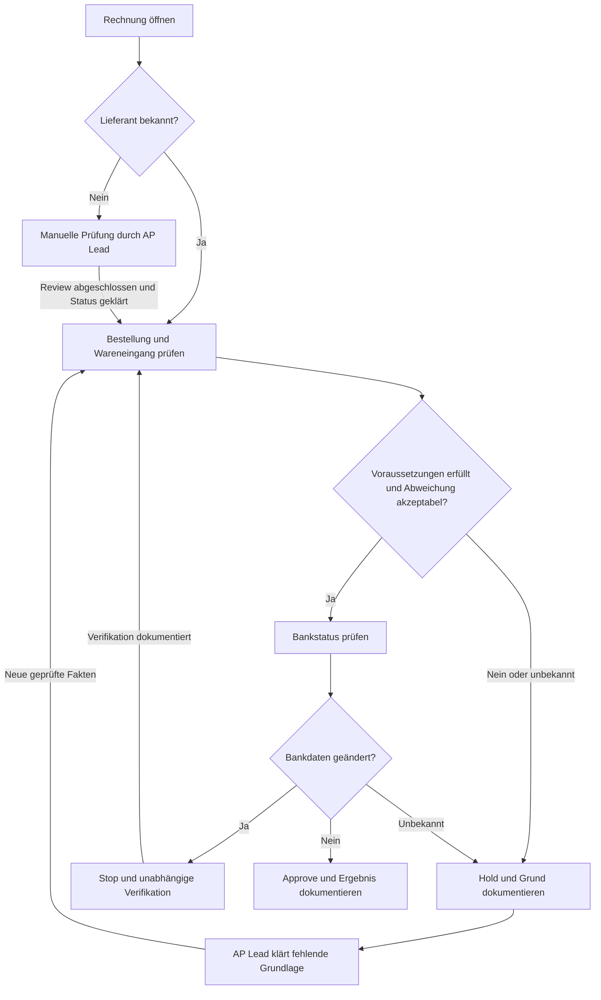
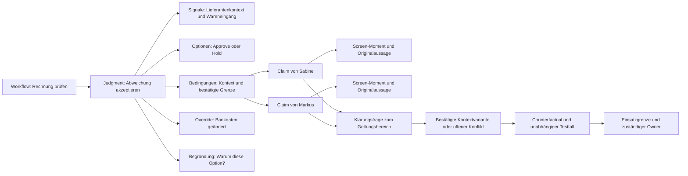
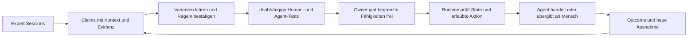
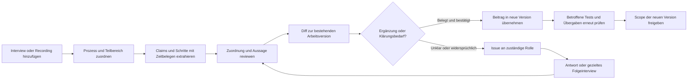

# Product RFC 001 — Operational Blueprint

**Produkt:** AI Apprentice · **Stand:** 3. Oktober 2026 · **Version:** 1.3  
**Status:** Finaler Konzeptentwurf für die MVP-Umsetzung; Teamfreigabe und Nutzervalidierung stehen aus.  
**Zeithorizont:** Hackathon-Fenster von 21 Stunden: 3. Oktober 2026, 18:00 Uhr bis 4. Oktober 2026, 15:00 Uhr (Europe/Berlin); anschließender Design-Partner-Pilot. Die aktuelle Planung im [Technical RFC 001 v1.1](./technical-rfc-001-operational-blueprint.md) ersetzt die frühere 24-Stunden-Annahme in Abschnitt 12. [Offizielle Agenda](https://luma.com/z3za7zow).  
**Leitentscheidung:** Eine Work Map für den vollständigen beobachteten Ablauf mit evidenzgestützter Entscheidungslogik, gelernt durch ein Gespräch während echter Bildschirmarbeit und geprüft an neuen Fällen.

## 1. Entscheidung in einer Minute

Wir bauen **Operational Blueprint**: einen sprachbasierten Apprentice, der einem Experten bei einer begrenzten Aufgabe zusieht, gezielt nach unsichtbaren Entscheidungsgründen fragt, sein Verständnis zurückerklärt und einen neuen Mitarbeiter anhand der bestätigten Logik coacht.

Das MVP bildet einen einzigen geschlossenen Loop ab:

**Expert arbeitet → Apprentice fragt → Work Map entsteht → Expert korrigiert und bestätigt → Learner bearbeitet neuen Fall → Tutor stoppt eine falsche Entscheidung vor dem Speichern → Transfer-Ergebnis wird sichtbar.**

Der erste Anwendungsfall ist die Prüfung von Lieferantenrechnungen in einem Sandbox-ERP. Der Produktkern bleibt horizontal. Ein AP-Kontextpaket liefert Begriffe, Feldtypen und mögliche Aktionen; die entscheidenden Regeln werden aus der Expert Session gelernt. Der wichtigste Produktnachweis ist die kausale Verbindung zwischen Expertenaussage und späterem Eingriff, nicht die Größe des Graphen.

Der erweiterte Produktkern führt **mehrere Interviews über Teilbereiche desselben Gesamtprozesses** zusammen. Experten übernehmen unterschiedliche Schritte und Verantwortlichkeiten; Senior-Experten können mehrere Bereiche oder Ausnahmen abdecken. Interviews und zeitlich abgegrenzte Recording-Segmente werden bestehenden oder neuen Prozessschritten zugeordnet. Ein Review-Loop prüft Ergänzungen, Überschneidungen, Handoffs und Widersprüche vor Veröffentlichung. Abschnitt 17 spezifiziert diese verbindliche Anforderung; der Expertenvergleich aus Abschnitt 16 ist ein Teil davon.

Die Oberfläche zeigt den vollständigen Produktlebenszyklus: **Capture → Blueprint → Evaluate → Teach → Improve → Control**. Die ersten vier Stationen bilden die Challenge-Schleife; Improve enthält Wissensverbesserung und Workflow-Optimierung, Control die belegte Einsatzgrenze. Drei Kernansichten mit zusätzlichen Tabs halten die Umsetzung klein; Abschnitt 5.4 definiert für jede Station den funktionierenden Umfang und den späteren Ausbau.

**Nutzerversprechen:** „Zeig deine Arbeit und erkläre die Entscheidungen. Dein Team erhält einen nachvollziehbaren Arbeitsablauf und kann an neuen Fällen prüfen, ob es ihn verstanden hat.“

**Positionierung:** *Turn expert work into a blueprint people can inspect, question and learn from.*  
**Langfristige Vision:** *The evaluation and control layer for operational judgment.*

## 2. Problem, Nutzer und erste kaufbare Wirkung

Ein erfahrener Operations-Mitarbeiter weiß, welche Abweichung akzeptabel ist, welche Ausnahme eine Freigabe verhindert und wer eine Eskalation auflösen darf. Ein Screen Recording zeigt die Handlung. Eine SOP beschreibt den Standardfall. Beides erklärt häufig nicht ausreichend, warum gerade dieser Fall anders behandelt wurde.

Die daraus entstehende Lücke ist konkret: Ein neuer Mitarbeiter kann den Klickpfad imitieren und trotzdem die falsche Entscheidung treffen. Ein Automation-Team kann denselben unvollständigen Prozess in einen Agenten übersetzen. Das MVP adressiert zuerst den Wissenstransfer auf Menschen; die spätere Agentenbewertung verwendet dieselbe Evidenzbasis.

| Rolle | Aufgabe im Produkt | Gewünschte Wirkung |
|---|---|---|
| Expert, etwa Senior AP Specialist | Arbeit zeigen, Gründe erklären, Modell korrigieren | Expertise weitergeben, ohne eine SOP schreiben zu müssen |
| Learner, etwa neuer AP-Mitarbeiter | Neue Fälle entscheiden und begründen | Ausnahmen erkennen und wissen, wann Hilfe erforderlich ist |
| Process Owner / Operations Lead | Bestätigten Blueprint und Transfer-Ergebnisse prüfen | Sichtbarkeit über Wissenslücken und verbleibenden Übungsbedarf |
| Späterer wirtschaftlicher Käufer | Head of Shared Services / Operations Excellence mit konkretem Automatisierungsprojekt | Dokumentierte Entscheidungsgrenzen als Grundlage für Training und Automation |

**Pilot-ICP als Hypothese:** DACH-/EU-Operations-Team mit wiederkehrender Bildschirmarbeit, mindestens einer schwer ersetzbaren Fachperson und messbaren Fehlern oder Rückfragen. Die in der Research genannte Größe von 20–200 Mitarbeitern ist ein Suchfilter, kein validierter Marktbeweis.

**Erstes kaufbares Angebot nach dem Hackathon:** Ein begrenzter „Judgment Readiness Audit“ für einen kritischen Workflow: Blueprint, Expertenbestätigung, Ausnahmen, Testfälle, Transfer-Ergebnisse und offene Fragen. Der Nutzen muss gegen die bisherige Einarbeitung und Dokumentation gemessen werden. Preis und Zahlungsbereitschaft bleiben zu validieren.

## 3. Produktthese und Abgrenzung

Die zu prüfende These lautet:

> Aktive, bildschirmbezogene Rückfragen plus Debrief erfassen zusätzliche Entscheidungslogik, die sich auf neue Fälle übertragen lässt und gegenüber passivem Screen-/Voice-Capture einen messbaren Vorteil erzeugt.

Screen Capture, Voice, Workflow Maps und In-App Guidance sind bereits angrenzende Produktfähigkeiten. Scribe dokumentiert Voice-Erklärungen und generierte Prozesskarten; Tango beschreibt Regeln und Validierung über Anwendungen hinweg; Latch bewirbt das Lernen aus vorgeführter Arbeit mit Rückfragen. Diese Primärquellen belegen angebotene Fähigkeiten, keine unabhängige Wirksamkeit. [Scribe Voice](https://support.scribehow.com/hc/en-us/articles/23111152407069-How-to-use-voice-transcription-while-creating-a-Scribe), [Scribe Process Maps](https://support.scribehow.com/hc/en-us/articles/38321547352989-Optimize-Process-Maps-and-how-to-export-them), [Tango](https://www.tango.ai/why-tango), [Latch](https://www.latch.ai/).

Die Differenzierung muss deshalb aus vier verbundenen Eigenschaften entstehen:

1. **Gezielte Elicitation:** Der Apprentice fragt nach etwas, das der Screen allein nicht erklärt.
2. **Evidenz pro Aussage:** Beobachtung, Expertenaussage und Modellvermutung bleiben unterscheidbar.
3. **Überprüfung:** Ein Gegenbeispiel kann eine unvollständige Regel sichtbar verändern.
4. **Transfer:** Ein neuer Fall wird mit genau dieser bestätigten Regel bewertet und erklärt.

Das ist eine Produktthese, kein bereits bewiesener technologischer Moat. Ein späterer Vorteil könnte aus versionierten Regeln, unabhängigen Testfällen, Expertenkonflikten und beobachteten Outcomes entstehen. Ein schöner Workflow-Graph allein erzeugt diesen Vorteil nicht.

## 4. Verbindliche Scope-Entscheidungen

| Entscheidung | Begründung |
|---|---|
| Workflow ist das Primärobjekt; Judgment hängt an Decision Nodes | Der Learner braucht Ablauf, Checks, Handoffs und Gründe gemeinsam. Ein isolierter Decision Tree reicht nicht. |
| Klickbare Timeline und kompakter Workflow-Graph sind Pflicht im Best Case | Die Timeline belegt einzelne Schritte; der Graph macht Varianten, Judgment Calls und Handoffs in der UI sichtbar. Ein freier Graph-Editor bleibt außerhalb des MVP. |
| Ein Workflow, ein Learner, ein Sandbox-ERP; ein Expert für den Challenge-Kern, mehrere Experten und Interviews für das erweiterte Produkt-MVP | Zuerst vollständiger Lernloop; anschließend einen Gesamtprozess aus zugeordneten Teilbeiträgen aufbauen und verfeinern. |
| Voice ist die zentrale Interaktion in Capture, Debrief und Teach | Erfüllt den Kern der ElevenLabs-Challenge. Text dient Sichtbarkeit und Fehlerbehebung. |
| Deutsch für Capture und Teach als Kern; Deutsch → Englisch als Best-Case-Stretch | Sprachwechsel gehört ausdrücklich zu den Stretch Goals, nicht zu den drei Pflichtmodulen. |
| Bestätigte Regeln werden versioniert; Tests beziehen sich auf eine feste Version | Verhindert, dass spätere Korrekturen alte Testergebnisse scheinbar weiter gültig machen. |
| Pre-save Gate ausschließlich im eigenen Sandbox-ERP | Nur dort kontrollieren wir den Commit verlässlich. Screen-Watching allein garantiert keinen rechtzeitigen Stopp. |
| Fachregeln werden nicht vorab in Tutor-Prompts oder Guardrail-Code hinterlegt | Sonst zeigt die Demo Retrieval oder ein Skript statt Lernen aus der Session. |
| Gecoachter Erfolg und eigenständiger Transfer werden getrennt ausgewiesen | Eine richtige Antwort nach Tutor-Hinweis belegt keine selbstständige Beherrschung. |
| AI-Ausführung bleibt deaktiviert | Ein einzelner Expert und wenige Sandbox-Tests rechtfertigen keine Produktionsdelegation. |

**P0 — unser verbindlicher Best-Case-MVP:** Live Screen Sharing, Vision Events, ElevenLabs Voice als Interviewer und Tutor, Expressive Mode soweit mit der gewählten Konfiguration verfügbar, drei passende Live-Fragen inklusive Guardrail, drei neue Debrief-Fragen, gesprochenes Teach-back mit ausdrücklicher Bestätigung, klickbare Work Map plus kompakter Graph, Counterfactual, neuer gecoachter Learner-Fall, zusätzlicher eigenständiger Transfer-Fall, Pre-save Interception mit Expertenbeleg, zeitlich verankerte Wiedergabe des Expertenmoments, sichtbare Off-record-Kontrolle, Session-Reset und Ergebnisansicht. Außerdem: alle sechs Lifecycle-Stationen in der UI; ein funktionierender Regelverbesserungs-Loop; evidenzgebundene Optimize-Vorschläge mit Review-Status.

**Erweitertes Produkt-MVP — verbindlicher nächster Umfang:** Einen Gesamtprozess aus mehreren Interviews mit unterschiedlichen Schrittzuständigkeiten aufbauen; Interviews und Recording-Segmente manuell oder mit AI-Vorschlägen zuordnen; mehrere Beiträge pro Schritt und mehrere Schritte pro Interview unterstützen; weitere Interviews an bestehende Prozesse anhängen; neue Erkenntnisse als Review-Diff prüfen und versioniert übernehmen; Abdeckung, Handoff-Lücken und mögliche Widersprüche mit Quellen sichtbar machen; Klärungsinterviews an offene Issues binden. Die Abnahme verwendet drei bis vier Experten mit teilweise überlappenden Bereichen und ein Folgeinterview. Hierfür gelten Abschnitt 16 und insbesondere 17. Das ist eine eigene Lieferung nach dem funktionsfähigen Challenge-Kern, falls sie nicht in die angenommenen 24 Stunden passt. Ein illustrativer Compare-Screen allein erfüllt diesen Funktionsumfang nicht.

**P1 — weitere Best-Case-Stretches:** Deutschsprachiger Expert und englischsprachiger Tutor; agentenlesbares Work-Map-Paket exportieren; eine bestätigte Workflow-Optimierung im Sandbox-ERP anwenden und gegen Guardrail-Regressionen prüfen; komfortable Regelbearbeitung und automatische Redaction über das bekannte Layout hinaus. Im PDF bleibt auch „zwei Experten“ ein Stretch Goal; für unsere Produktentwicklung erhält es die oben genannte höhere Priorität.

**Nicht im MVP:** Beliebige Fremdanwendungen, Desktop Recorder, SAP-Anbindung, Multi-Tenant-Administration, allgemeiner BPMN-Editor, Process Mining, Always-on Capture, unternehmensweites Process Mining aus beliebig vielen Aufnahmen, Produktionsmonitoring, autonome AI-Ausführung und automatische „Safety“-Freigabe. Mehrere Interviews und Experten mit expliziter Schrittzuordnung gehören zum erweiterten Produkt-MVP; vollständig automatische Prozessrekonstruktion ist dafür keine Voraussetzung.

**Abgrenzung zum PDF-Minimum:** Das PDF verlangt keinen beliebigen Graph-Editor, kein Optimize-Modul und keine vollständige Agentenplattform. Wir nehmen den kompakten Graph, eigenständigen Transfer und den Improve-/Optimize-Einstieg bewusst in unseren Best-Case-Umfang auf. Bei Zeitmangel wird ein kleinerer Umfang als solcher ausgewiesen; er wird nicht als erfüllter Best Case bezeichnet. Abschnitt 15 trennt diese Ebenen ausdrücklich.

## 5. End-to-End-Nutzererlebnis

### 5.1 Capture — „Teach Apprentice“

Der Expert startet eine explizite Session und teilt ausschließlich den Sandbox-ERP-Tab. Vor Beginn sieht er, welche Daten verarbeitet werden, und kann die Session abbrechen. Der Apprentice hört zu und zeigt wenige verständliche Zustände: **Beobachtet**, **Frage wartet**, **Hört zu**, **Off record**, **Verbindung unterbrochen**.

Das ERP ist die Hauptfläche; ein schmales Side Panel zeigt die Stimme, den aktuellen Kontext und maximal drei jüngste semantische Events. Die UI zeigt keine ständig wachsende Rohtranskription als Hauptprodukt.

Der Expert arbeitet einen 5–10-minütigen Rechnungsprüfungs-Workflow mit mehreren Fällen ab. Der Apprentice fragt insgesamt drei bis fünf Mal an passenden Pausen. Ein sichtbarer Lieferantenwechsel, eine akzeptierte Abweichung oder eine Eskalation kann eine Frage auslösen. Eine Frage muss an ein konkretes ScreenEvent gebunden sein und eine bislang offene Information adressieren.

Der Expert kann eine Frage verschieben, Off record einschalten oder die Aufgabe beenden. Die App fordert ihn nicht zum künstlichen Warten auf, damit sie ihre Quote erfüllt. Sind weniger als drei geeignete Live-Fragen entstanden, gilt die Challenge-Abnahme als nicht erreicht.

### 5.2 Work Map & Verify — „Das habe ich verstanden“

Nach Ende der Aufgabe entsteht eine vorläufige Work Map aus Events und Aussagen. Die Timeline zeigt aggregierte Arbeitsschritte statt einzelner Mausbewegungen. Ein Schritt öffnet Screen-Moment, beobachtete Handlung, Entscheidungsgrund in den Worten des Experten, Guardrails und noch offene Fragen.

Normale Schritte werden im Teach-back ebenfalls begründet und bestätigt. Auch sie erhalten einen Bezug zu einem Screen-Moment und zu einem tatsächlich gesprochenen Transcript-Segment. Wenn der Grund fehlt, zeigt die App „noch nicht erklärt“ und fragt nach, statt ihn zu erfinden.

Der Apprentice führt einen gesprochenen Debrief mit mindestens drei **zuvor unbeantworteten** Folgefragen. Mindestens eine überprüft die Regel an einem Gegenbeispiel. Danach erklärt er den gesamten Ablauf in unter einer Minute zurück. Der Expert kann korrigieren; die App erzeugt eine neue Version und lässt die geänderte Aussage erneut bestätigen.

Erst nach ausdrücklicher Bestätigung und Schließen der kritischen Lücken wird die Version für den Tutor veröffentlicht. Der Button heißt **„Für diese Übung bestätigen“**. Bestätigung beschreibt das Verständnis dieses Experten, keine verbindliche Unternehmenspolicy.

### 5.3 Teach & Results — „Entscheide einen neuen Fall“

Der Learner teilt seinen eigenen Sandbox-Tab. Der Tutor verwendet ausschließlich die veröffentlichte Blueprint-Version, fragt nach der nächsten Entscheidung und kann deren Grund erklären. Die Falllösung wird nicht beim Start vorgelesen.

Vor jeder entscheidenden Aktion erzeugt das ERP eine Pending Action. Der Commit bleibt gesperrt, bis die aktuellen Fakten gegen die bestätigten Regeln geprüft wurden. Bei einer Verletzung erklärt der Tutor den Stopp, zeigt den Expertenbeleg und lässt den Learner die passende Aktion auswählen.

Beispiel: „Die Bankdaten wurden geändert. Der Expert hat erklärt, dass du dann zuerst unabhängig verifizieren lassen musst. Welcher Schritt ist jetzt richtig?“ Die Karte verweist auf die ursprüngliche Aussage und ihren Screen-Kontext. Die Korrektur wird als **mit Hilfe gelöst** protokolliert.

Die Ergebnisansicht zeigt konkrete beobachtete Leistungen: korrekte Erstentscheidung, Stopp vor Commit, Hilfe erhalten, korrigierte Aktion, Begründung und verbleibender Übungsbedarf. Sie zeigt keine pauschale „Mastered“-Bewertung nach einer einzigen begleiteten Aufgabe.

Im anschließenden Assessment bearbeitet der Learner L-03 ohne vorweggenommene Erklärung, Hinweise oder Replay. Er nennt zunächst die Entscheidung und den Grund. Das Gate bleibt aktiv, aber seine Intervention zählt als Hilfe und beendet für diesen Versuch den eigenständigen Erfolgsnachweis. Die Ergebnisansicht unterscheidet **selbstständig gezeigt**, **mit Hilfe gelöst** und **noch üben** je Lernziel. Ein weiteres neues Testbeispiel ist nötig, wenn der erste Versuch Hilfe brauchte.

Bei einer Intervention kann der Learner **„Zeig mir den Expertenmoment“** öffnen: den maskierten Evidence-Frame am richtigen Zeitpunkt und das zugehörige tatsächlich gesprochene Audiosegment. Die UI kennzeichnet Beobachtung, spätere Erklärung und hypothetische Debrief-Antwort getrennt. Es wird kein synthetisch gesprochenes Zitat als Originalaufnahme ausgegeben. Falls kein originales Audiosegment vorliegt, wird die tatsächliche Aussage als Transcript gezeigt und die eingeschränkte Replay-Funktion sichtbar benannt.

### 5.4 Vollständiger Produktlebenszyklus in der UI

Ein gemeinsamer Blueprint-Header zeigt Workflow, Version, Expert, Status, offene kritische Lücken und die Datenbasis. Eine kleine Library enthält bereits den einen echten MVP-Blueprint; mehrere Workflows sind ein erkennbarer späterer Ausbau. Alle Stationen sind erreichbar, aber weiterführende Fähigkeiten haben nachvollziehbare leere oder geplante Zustände statt erfundener Ergebniszahlen.

| Station | Funktioniert im Best-Case-MVP | Späterer Ausbau in der UI |
|---|---|---|
| Capture | Live Session, Kontext-Events, Fragen, Aufnahme-/Off-record-Status | Zweiter Expert im erweiterten Produkt-MVP; später ausdrücklich gestartete Delta-Captures |
| Blueprint | Klickbare Timeline **und** kompakter Graph; Gründe, Ausnahmen, Guardrails und Evidence Drawer | Größere Workflow-Library, mehr Varianten und Anwendungen |
| Evaluate | Offene Fragen, Counterfactual, Expertenbestätigung, konkrete Testfälle mit Version und Ergebnis | Multi-Expert-Konflikte, Policy-Abgleich, unabhängige Human-/Agent-Testsets |
| Teach | Voice-Tutor, Entscheidungsvorhersage, Pre-save-Stopp, Experten-Replay, anschließendes Assessment | Weitere Übungen und Lernpfade auf Basis tatsächlicher Fehler |
| Improve | Tabs **Knowledge** und **Optimize**: Regelkorrektur mit Diff, Bestätigung und erneutem Test; nachvollziehbare Workflow-Vorschläge | Angewandte Änderungen, gemessene Ergebnisse und neue Evidenz |
| Control | „Sandbox-Übung freigegeben“; „Produktionsfreigabe ausstehend“; „AI-Ausführung deaktiviert“ mit Begründung | Agentenfreigaben, zuständiger Owner, Integrationen, Widerruf und Monitoring |

Die Funktionen brauchen keine sechs separaten Seiten. Capture ist die Live-Ansicht; Blueprint/Evaluate/Improve teilen Map und Evidence Drawer; Teach/Results/Control teilen Übungs- und Ergebnisansicht. Die Navigation bleibt dennoch sichtbar, damit die Company Vision aus dem MVP heraus verständlich wird.

Die Blueprint-Ansicht bietet die Unteransichten **Workflow · Wissen · Expertenvergleich**. Evaluate bietet **Counterfactuals · Human Tests · Agent Tests**. Agent Tests zeigen vor einem echten Lauf einen leeren Zustand, keine positiven Ergebnisse. Eine ausgewählte Entscheidung bleibt beim Wechsel zwischen Workflow, Wissen, Vergleich und Tests ausgewählt. Die visuelle Spezifikation in 16.2–16.5 ist Bestandteil dieses RFC.

### 5.5 Improve und Optimize als konkrete Produktfunktionen

**Improve verbessert das Wissensmodell:** Eine fehlende Voraussetzung, unklare Eskalation oder ein gescheiterter Test wird als Issue mit Originalbeleg gezeigt. Der Expert ergänzt die Aussage. Die App zeigt die Änderung, erzeugt eine neue Version, lässt sie bestätigen und führt betroffene Tests erneut aus. C-01 liefert hierfür den ersten echten MVP-Loop. Eine bloße LLM-Zusammenfassung ohne Bestätigung gilt nicht als Verbesserung.

**Optimize verbessert die Durchführung der Arbeit:** Aus beobachteten Checks, Navigation und ausdrücklich genannten Reibungspunkten entstehen Vorschläge, nicht automatisch neue verbindliche Prozesse. Jede Karte enthält Problem, Evidence, vorgeschlagene Änderung, betroffene Guardrails, zu prüfende Annahme und einen Status `suggested / expert_reviewed / approved_for_sandbox / tested / rejected`.

Beispiel, **nur wenn die Session den Reibungspunkt belegt**: „Lieferanten-/Bankstatus im Rechnungs-Review anzeigen, damit der erforderliche Check keinen zusätzlichen Ansichtswechsel braucht.“ Der Vorschlag erhält keine erfundene Zeitersparnis. Bankstatus muss aktuell und eindeutig sein; der Stopp bei Bankänderung bleibt bestehen. Ist diese Datenaktualität nicht gewährleistet, muss der Expert den Vorschlag zurückweisen oder einschränken.

Im Best-Case-MVP funktioniert die Vorschlags- und Review-Strecke mit mindestens einem tatsächlich begründeten Vorschlag. Fehlt ein belegbarer Reibungspunkt, zeigt die UI „Noch kein belegter Vorschlag“; künstliche Optimierungen sind kein Bestehenskriterium. Der Best-Case-Stretch wendet einen bestätigten Vorschlag per begrenztem Sandbox-Layoutwechsel an und wiederholt Positiv-/Stop-Tests. Das ist ein kontrollierter Prototyp, keine allgemeine ERP-Änderung oder nachgewiesene Produktivitätssteigerung.

**Verbesserungszyklus:** Capture → bestätigter Blueprint → Test findet Lücke oder Expert nennt Reibung → Änderungsvorschlag → Review → neue Version → Regressionstest → neues Ergebnis. Automatisch erkannte Ineffizienz, gemessener ROI und Prozessänderung in beliebigen Anwendungen bleiben spätere Fähigkeiten.

## 6. Demo-Workflow und Lernbeweis

### 6.1 Kontext vor der Session

Der Apprentice darf die Aufgabe „Lieferantenrechnung prüfen“, Feldnamen und Datentypen sowie die Aktionen `approve`, `hold` und `escalate` kennen. Er darf wissen, dass Rechnungen, Bestellungen, Wareneingang und Lieferantendaten relevante Objekte sind.

Er erhält vorab **keine** Freigabegrenze, keine Toleranzregel, keinen Bankdaten-Override und keine Eskalationszuständigkeit. Grundmodelle besitzen allgemeines Vorwissen; dieses Vorwissen darf jedoch keinen als gelernt ausgewiesenen oder ausführbaren Regelbaustein ohne Session-Evidenz erzeugen.

Die folgenden Werte sind **fiktive Sandbox-Regeln**, keine Aussage über Buchhaltungsvorschriften. Ein Teammitglied spielt den Expert und kennt diese Regeln außerhalb des Apprentice-Kontexts. Die Fallauswahl ist vorbereitet; Gespräch, Extraktion und daraus abgeleitete Regel entstehen live.

### 6.2 Fachlogik, die der Expert vermittelt

Für bekannte Lieferanten mit passender Bestellung darf eine Mengenabweichung unter 2 % akzeptiert werden, **wenn der Wareneingang bestätigt ist**. Bei 2 % oder mehr wird die Rechnung gehalten und geprüft. Geänderte Bankdaten verhindern jede direkte Freigabe, unabhängig von der Mengenabweichung. Ein AP Lead muss eine unabhängige Verifikation über den bereits bekannten Kontakt dokumentieren; erst danach darf erneut geprüft werden. Neue Lieferanten gehen zur manuellen Prüfung. Fehlende entscheidende Informationen führen zu „nicht freigeben; klären“.

Das Produkt soll diese Logik aus dem Expertengespräch lernen. Der Implementierungscode kennt Feldtypen und erlaubte Aktionen, aber weder die 2-%-Grenze noch den Bankdaten-Override.

| Fall | Zweck | Sichtbare Merkmale | Fachlich erwartete Aktion |
|---|---|---|---|
| E-01 | Expert zeigt akzeptierte Ausnahme | Bekannter Lieferant, Bestellung passend, 1,5 % Abweichung, Wareneingang bestätigt, Bankdaten unverändert | Approve |
| E-02 | Expert zeigt Abweichungsgrenze | Anderer bekannter Lieferant, 2,4 % Abweichung, Wareneingang bestätigt | Hold |
| E-03 | Expert zeigt Stop-/Review-Pfad | Neuer Lieferant, geringe Abweichung, vollständige Rechnung | Escalate zur manuellen Prüfung |
| C-01 | Debrief-Gegenbeispiel | E-01, aber Wareneingang nicht bestätigt | Hold; fehlende Voraussetzung ergänzen |
| L-01 | Neuer gecoachter Learner-Fall | Neuer Datensatz eines bekannten Lieferanten, 0,9 % Abweichung, passender PO, bestätigter Wareneingang, Bankdaten geändert | Escalate; versuchtes Approve blockieren |
| L-02 | Positivkontrolle | Neuer Datensatz, bekannter Lieferant, 1,1 % Abweichung, übrige Voraussetzungen erfüllt | Approve erlauben |
| L-03 | Verbindlicher eigenständiger Transfer-Test im Best Case | Neuer Datensatz, geringe Abweichung, Wareneingang nicht bestätigt | Ohne Tutor-Hinweis Hold wählen und fehlende Voraussetzung begründen |

E-01 bis E-03 sind Session-Material. C-01 ist ein explizit hypothetischer Test, keine beobachtete Expert-Aktion. L-01 bis L-03 werden nicht in Capture oder Debrief gezeigt. Sie prüfen neue Kombinationen der gelernten Merkmale, keine vollständig unbekannte Fachdomäne.

### 6.3 Drei Live-Fragen und drei echte Debrief-Lücken

**Mögliche Live-Fragen, vom Event ausgelöst:**

1. Nach E-01: „Du akzeptierst die Abweichung. Was macht sie in diesem Fall akzeptabel?“
2. Nach E-02: „Bei dieser Rechnung hältst du an. Ab welcher Abweichung würdest du das tun?“
3. Nach Lieferantenprüfung: „Was prüfst du hier vor der Freigabe, und was würde dich unabhängig von der Abweichung stoppen?“

Die Antworten können die Toleranz und den Bankdaten-Stopp erklären. Der Agent protokolliert nur, was tatsächlich gesagt wurde. Die Fragen sind Beispiele, kein unveränderlicher Interviewtext.

**Mögliche Debrief-Fragen, nur sofern noch offen:**

1. „Gleicher Fall wie eben, aber ohne bestätigten Wareneingang: Dürfte ich die kleine Abweichung trotzdem freigeben?“
2. „Was gilt genau bei 2,0 %, und wer übernimmt die Prüfung einer gehaltenen Rechnung?“
3. „Wer darf den Bankdaten-Stopp auflösen, und welchen Nachweis brauchst du, bevor du weiterarbeitest?“

Falls der Expert einen Punkt schon live beantwortet hat, wählt das System eine andere tatsächliche Lücke, etwa den Review-Pfad bei einem neuen Lieferanten. Drei neue Fragen müssen im vorbereiteten vollständigen Testlauf möglich sein. Wiederholte Antworten werden nicht als neue Debrief-Erkenntnis gezählt.

### 6.4 Ehrlicher Counterfactual-Moment

Die frühe Draft-Regel kann „bekannter Lieferant + passende Bestellung + Abweichung unter der genannten Grenze → freigeben, sofern keine Bankänderung“ lauten. C-01 deckt auf, dass die Wareneingangsbestätigung eine zusätzliche Voraussetzung ist. Der Expert ergänzt diese Bedingung; die UI zeigt die tatsächliche Änderung von v1 auf v2 samt Beleg.

Wenn der Expert die Voraussetzung bereits live genannt hat, bestätigt C-01 die bestehende Regel. Die App behauptet dann keine neu entdeckte Ausnahme. **Ein bestandener Test und eine korrigierte Regel sind unterschiedliche Ergebnisse.**

### 6.5 Beweiskette gegen eine geskriptete Demo

Vor Capture ist keine ausführbare Fachregel vorhanden. Danach besitzt jede eingesetzte Regel einen echten Transcript-Beleg. Der Tutor kann keine verborgene Musterlösung aus dem Fallkatalog lesen. Eine getrennte Bewertungsfunktion kennt die erwarteten Antworten, liefert sie aber weder dem Interviewer noch dem Tutor.

Als wichtiger Abnahmetest nennt der Expert in einer frischen Session eine andere Toleranz, etwa 1 %. Der neue Blueprint und Tutor müssen sich entsprechend ändern. Bleibt der Tutor bei 2 %, ist der Lernnachweis fehlgeschlagen. Fixtures und Replays sind erlaubt, müssen sichtbar als solche gekennzeichnet werden und zählen nicht als Live-Nachweis.

### 6.6 „What Good Looks Like“ als Best-Case-Ziel

Das PDF nennt auf S. 7 einen anschaulichen Maßstab: drei Rechnungen, sieben Schritte, drei Judgment Calls und vier Guardrails mit Belegen. Diese Zahlen stehen im Beispiel, nicht in den separaten Required-Boxen. Wir übernehmen sie dennoch als konkrete Zielgröße für unseren Best Case, ohne fehlende Erkenntnisse künstlich zu erzeugen.

| Ziel | Abbildung im eigenen AP-Workflow |
|---|---|
| Drei Expert-Fälle | E-01, E-02 und E-03 mit unterschiedlichem Ausgang |
| Sieben semantische Schritte | Rechnung öffnen, Lieferant bestimmen, Bestellung vergleichen, Wareneingang prüfen, Bankstatus prüfen, entscheiden, Ergebnis/Handoff dokumentieren |
| Drei Judgment Calls | J1: bekannter oder neuer Lieferant; J2: Mengenabweichung unter Berücksichtigung des Wareneingangs akzeptabel; J3: Freigabe zulässig oder Bankdaten-Stopp |
| Vier fachliche Guardrails | Neuer Lieferant → manuelle Prüfung; Abweichung ≥ bestätigte Grenze → Hold; unbestätigter Wareneingang → Hold; geänderte Bankdaten → unabhängige Verifikation |
| Alle Belege zugänglich | Jeder Schritt und Guardrail verlinkt passenden Screen-Kontext plus tatsächliche Expertenworte; unobservierte Ausnahme explizit markiert |
| Expert korrigiert Verständnis | Ein echter fehlender Kontext wird ergänzt; falls bereits vollständig erklärt, ehrliche Bestätigung statt gespielter Korrektur |
| Judge kann den Ablauf nutzen | Ein Judge kann Expert-Rolle übernehmen, ein anderer einen neuen Learner-Fall bearbeiten; keine Pflicht zur festen Teammitglied-Besetzung |
| Sichtbarer Transfer | Gecoachter Fall plus weiterer eigenständig entschiedener Fall; verbleibender Übungsbedarf je Lernziel |

Die CAPEX-Grenze und der Dezember-Doppelrechnungsfall aus dem PDF sind Beispiele. Unser eigener Workflow darf andere Judgment Calls verwenden, da das Briefing die Domäne ausdrücklich freistellt. Die Vergleichbarkeit entsteht durch die vollständige Lern-, Evidenz- und Teach-Schleife.

## 7. Verhaltensregeln des Apprentice

### 7.1 Wann er fragt

Jeder Fragenkandidat enthält Event-Bezug, offene Information und Priorität. Stop-/Eskalationsgrenzen haben Vorrang, danach Gründe für Verzweigungen, Bedingungen und Ausnahmen. Sichtbare Tatsachen werden nicht erneut abgefragt.

Als erste Prototypwerte gelten: keine laufende Expert- oder Agent-Sprache; seit etwa zwei Sekunden kein Tastatur-/Pointer-Ereignis; stabiler Bildschirm seit mindestens 1,5 Sekunden; mindestens 30 Sekunden Abstand zur letzten Frage; maximal fünf Live-Fragen pro zehn Minuten. Diese Werte sind abzustimmende Heuristiken, keine wissenschaftlich validierten Schwellen.

VAD zeigt Sprachaktivität, nicht ob jemand liest. Stille und ein stabiler Screen sind deshalb allein keine Freigabe zum Sprechen. Die Policy bevorzugt abgeschlossene Check-/Navigationsabschnitte. Bei unklarer Lesesituation bleibt die Frage in der Queue; der Expert kann „Frag jetzt“ signalisieren. Beginnt er wieder zu sprechen, muss die Agent-Stimme unterbrochen werden können.

Tastatur- und Pointer-Aktivität lässt sich zuverlässig im instrumentierten Sandbox-Tab erfassen. Ein beliebiger geteilter Fremd-Tab liefert diese Signale nicht automatisch. Diese Grenze gehört zum MVP-Scope und wird nicht als gelöst dargestellt.

### 7.2 Was er fragt

Eine Frage muss mehr Wissen versprechen als das bereits sichtbare Event: „Warum hast du trotz Abweichung freigegeben?“ statt „Hast du freigegeben?“ Sie fragt möglichst nur nach einem Thema, wartet die Antwort ab und ordnet die Antwort dem zugehörigen Moment zu.

Fragen über nicht sichtbare Daten dürfen als fehlender Kontext gestellt werden. Behauptungen über Lieferantenhistorie oder Policies werden nicht aus einer GUI geraten. Unklare oder widersprüchliche Antworten bleiben als Lücke sichtbar.

### 7.3 Wann er genug verstanden hat

„Verstanden“ bedeutet **für die begrenzte Übung ausreichend bestätigt**, nicht vollständig bekannt. Der Debrief endet nur, wenn:

- mindestens drei neue Folgefragen beantwortet wurden;
- der Ablauf und die verwendeten Entscheidungen nachvollziehbar sind;
- jede kritische Regel einen Trigger, die verbotene/erforderliche Aktion und einen echten Beleg besitzt;
- offene Eskalationen eine Zuständigkeit und Wiederaufnahmebedingung haben;
- ein Gegenbeispiel beantwortet und im Modell berücksichtigt ist;
- keine ungelöste kritische Inkonsistenz vorliegt;
- der Expert das finale gesprochene Teach-back ausdrücklich bestätigt.

Ziel sind höchstens fünf Minuten Debrief. Reicht die Zeit nicht, lautet der Status **„Review erforderlich“**, und der Tutor erhält diese Version nicht als autoritative Regelbasis. Fehlende Antworten werden nicht durch den Zeitablauf ersetzt.

## 8. Work Map, Evidenz und Regelmodell

Die erste Timeline aggregiert den Rechnungsprüfungs-Workflow in sieben Schritte: **Rechnung öffnen → Lieferant identifizieren → Bestellung vergleichen → Wareneingang prüfen → Lieferanten-/Bankstatus prüfen → Approve/Hold/Escalate entscheiden → Ergebnis und gegebenenfalls Handoff dokumentieren**. Ein Hold-/Eskalationspfad endet für den aktuellen Bearbeiter am Handoff. Die erklärte Wiederaufnahme nach einer Verifikation bleibt als beschriebener Zweig sichtbar, bis sie tatsächlich beobachtet wurde.

Diese Reihenfolge ist eine UI- und Demo-Planung, kein vorab gelernter Blueprint. Der veröffentlichte Ablauf entsteht aus der tatsächlichen Session. Weicht der Expert ab, muss die Map diesen Ablauf wiedergeben oder den Unterschied ausdrücklich als ungeklärt markieren.

### 8.1 Minimale Produktobjekte

| Objekt | Erforderlicher Inhalt |
|---|---|
| Session | Rolle, Aufgabe, Sprache, Start/Ende, Capture-Modus, Off-record-Intervalle |
| ScreenEvent | Zeit, Fall-ID, semantisches Ereignis, sichtbare Fakten, Frame-Bezug, Herkunft |
| TranscriptSegment | Sprecher, Zeitspanne, tatsächlich gesprochener Text, Bezug zu Frage/Event |
| WorkflowStep | Typ `task / check / decision / handoff / wait / end`, Anwendung, zuständige Rolle, erforderliche Fakten, Abschlussbedingung, Screen-Beleg, Expertenbegründung |
| WorkflowEdge | Typ `sequence / conditional / exception / handoff / return`, Start-/Ziel-ID, Bedingung und Evidenz; bildet Varianten und Wiederaufnahme ab |
| JudgmentRule | Bedingungen, Ausnahmen, erlaubte/verbotene Aktion, Eskalationsweg, Quellen |
| BlueprintVersion | Schritte, Verzweigungen, Regeln, offene Lücken, ausdrückliche Expertenbestätigung |
| ExpertClaim | Expert-/Session-ID, konkrete Behauptung, Geltungsbereich, Zeit/Quelle, Bestätigung und mögliche Gegenbelege |
| Process | Stabile ID, Ziel, Start-/Endgrenze, Owner, aktuelle veröffentlichte Version und Arbeitsentwurf |
| ContributionAssignment | Interview-/Recording-ID, Segment-Zeitspanne, Process-/Step-IDs, Beitragsart, Geltungsbereich, Zuordnungsreview und Herkunft |
| ResponsibilityAssignment | Person/Rolle, Schritt-/Entscheidungsbereich, Art der Verantwortung, Geltungsbereich, Gültigkeitszeitraum und Bestätigung |
| ChangeProposal | Basisversion, neue/geänderte Schritte oder Claims, betroffene Regeln/Tests, Review-Entscheidung und resultierende Version |
| ComparisonIssue | Vergleichbare Entscheidung, beteiligte Claims, gemeinsamer Kontext, Unterschiede, offene Klärungsfrage und Auflösung |
| KnowledgeRelation | Typisierte Verbindung wie `supports / contradicts / exception_to / applies_in / requires / tested_by`; Herkunft und Version |
| TestCase | Ursprung `counterfactual / held_out`, Fakten, geprüfte Regeln, getrennte Musterlösung |
| TestResult | Blueprint-Version, erste Entscheidung, Intervention, Hilfe, finale Entscheidung, Ergebnis |

Unbeobachtete Varianten dürfen im Blueprint erscheinen, wenn der Expert sie erklärt. Sie werden als **beschrieben, nicht beobachtet** markiert und mit dem relevanten Screen-Kontext sowie der Aussage verknüpft. Ein Frame des Basisfalls beweist nicht, dass der hypothetische Ausnahmefall tatsächlich auf dem Bildschirm auftrat.

### 8.2 Mehrere unabhängige Evidenzdimensionen

Keine globale Confidence-Prozentzahl und keine einzige lineare Statusleiter. Eine Regel kann gleichzeitig vom Expert bestätigt, an einem Gegenbeispiel getestet und mit einer Policy im Konflikt sein.

- **Herkunft:** `model_prior`, `screen_observation`, `expert_statement`, später `company_policy`.
- **Review:** `draft`, `expert_confirmed`, `conflicted`, `stale`.
- **Tests:** konkrete Ergebnisse mit Fall-ID, Regelversion, Hilfe und Erstentscheidung.
- **Nutzung:** `exercise_only`; Produktionsrechte werden im MVP nicht vergeben.

Ein beobachtetes Verhalten beweist die Handlung, nicht ihren Grund. Ein Modellvorschlag bleibt Draft. Expertenbestätigung wird nicht zu Policy-Validierung umetikettiert. Die UI zeigt beispielsweise „Expert bestätigt · 1 Gegenbeispiel geprüft · 1 Fall mit Hilfe gelöst · keine Produktionsdaten“.

### 8.3 Ausführbare Regeln aus bestätigtem Wissen

Freitext bleibt für die Erklärung erhalten. Für den Sandbox-Check wird eine bestätigte Regel zusätzlich in eine kleine, typisierte Struktur überführt. Erlaubt sind bekannte Feldnamen, Vergleichsoperatoren, AND/OR und Aktionen; kein frei generierter ausführbarer Code. Der Expert sieht die resultierende Bedingung vor Veröffentlichung.

Beispiel **nach** der Session:

```json
{
  "rule_id": "bank_change_stop",
  "blueprint_version": 2,
  "when": {"field": "bank_details_changed", "op": "eq", "value": true},
  "prohibit": ["approve"],
  "require": "independent_verification",
  "route_to": "ap_lead",
  "evidence": ["screen_event_014", "expert_answer_003", "debrief_answer_003"],
  "review": "expert_confirmed",
  "usage": "exercise_only"
}
```

Die IDs und Version sind illustrative Beispiele. Produktion und Demo dürfen keine erfundenen Zitate oder nicht vorhandenen Evidence-IDs veröffentlichen. Die Regelengine ist generisch; Feldnamen stammen aus dem Kontextpaket, Bedingungen und Werte aus der bestätigten Session.

**Konfliktpriorität:** bestätigter harter Stopp vor allgemeiner Freigaberegel. Bei widersprüchlichen bestätigten Regeln oder fehlenden entscheidenden Fakten lautet das Ergebnis `unknown / review_required`. `null` ist nicht gleich `false`. Ein Regel-Update erzeugt eine neue Version; betroffene Tests gelten für diese neue Version als erneut auszuführen.

## 9. Technische Produktgrenzen und Referenzarchitektur

```text
Sandbox-Tab → freigegebene Screen-Frames → Vision → ScreenEvents
                              │                         │
Mikrofon → ElevenLabs Voice ───┴── Timing-/Question-Policy
                              │
                 Events + Transcript + Antworten
                              ↓
                 Draft Work Map + offene Lücken
                              ↓
           Voice-Debrief → Bestätigung → feste Version
                              ↓
Learner-Screen → aktuelle Fakten → generischer Regelcheck
                              ↓
         Pending Action → Commit-Gate → Tutor-Erklärung
                              ↓
                       TestResult + Evidence
```

**Vorgeschlagene Umsetzung:** eine Web-App mit React/TypeScript, kleinem Server für Secrets, Vision-Aufrufe und strukturierte Extraktion, ElevenLabs Agents für Interviewer und Tutor sowie einem Vision-fähigen Modell für ScreenEvents. Persistenz zunächst sessionbezogen; eine einfache lokale Datenablage genügt. Das RFC verpflichtet nicht auf einen bestimmten LLM-Anbieter.

Frame-Sampling startet mit einem Bild alle ein bis zwei Sekunden und einem Delta-Gate gegen redundante Aufrufe. Events erhalten monoton steigende Sequenzen, Fall-ID und Session-Zeit. Veraltete Antworten eines Vision-Aufrufs dürfen den aktuellen Fall nicht überschreiben. Transcript und Events werden über denselben Session-Zeitbezug verbunden.

Der Screen-Observer bleibt für die Demo real. Ein schmaler Sandbox-Adapter liefert Aktivitätssignale, fallbezogene aktuelle Werte und die Commit-Grenze. Die UI und Logs unterscheiden Vision-Beobachtung von App-State. Der Adapter liefert keine fachliche Antwort und darf Screen Capture nicht heimlich durch vollständige Ereignis-Fixtures ersetzen.

Der Voice-Agent erhält kompakte Textupdates aus den ScreenEvents; Bilder werden separat interpretiert. Das React SDK dokumentiert `sendContextualUpdate` ohne unmittelbaren Antworttrigger, `sendUserMessage` mit Gesprächsantwort und `sendUserActivity` zur vorübergehenden Unterdrückung von Unterbrechungen. Client Tools können UI-Funktionen bereitstellen, etwa Evidenz anzeigen oder aktuelle Fakten abfragen. Diese Fähigkeiten ersetzen nicht die eigene Timing-Policy. [ElevenLabs React SDK](https://elevenlabs.io/docs/eleven-agents/libraries/react).

Die Voice-Konfiguration startet mit geduldigem Turn-Taking und aktivierbaren Unterbrechungen durch den Nutzer. Das ist eine zu prüfende UX-Einstellung, keine Timing-Garantie. Für den Best Case wird außerdem die im PDF genannte Expressive-Mode-Konfiguration für einen neugierigen, geduldigen Interviewer und Tutor geprüft und in der Demo dokumentiert. [ElevenLabs Conversation Flow](https://elevenlabs.io/docs/eleven-agents/customization/conversation-flow).

Für den an der Referenz des PDF ausgerichteten Best Case wird Scribe v2 Realtime als explizite Capture-Transkript-/Timing-Quelle eingeplant. Es unterstützt partielle und bestätigte Transkripte sowie manuelle oder VAD-basierte Segmentbestätigung. Agent-eigene Sprachsignale bleiben für das Gespräch verfügbar; der zusätzliche Stream ist eine bewusste Kosten-/Komplexitätsentscheidung zugunsten der Briefing-Nähe. Falls eine einfachere Agent-Pipeline verwendet wird, ist diese Abweichung im Audit sichtbar und erfüllt nicht dieses technische Best-Case-Ziel. [ElevenLabs Realtime Transcripts](https://elevenlabs.io/docs/eleven-api/guides/how-to/speech-to-text/realtime/transcripts-and-commit-strategies).

Der Tutor bekommt die bestätigte Work Map als versiongebundene Wissensbasis und Ablaufanweisung. Im Best Case wird die vom PDF vorgeschlagene Knowledge-Base-/Procedures-Anbindung umgesetzt, sofern die gewählte Kontokonfiguration sie trägt. Ein einfacherer Runtime-Kontext mit Lookup-Tool ist ein kenntlich gemachter Implementierungsersatz; er darf keine alte Version oder Draft-Regeln liefern. Der erste technische Durchstich prüft diese Bindung sowie Expressive Mode und Scribe, bevor der Best-Case-Scope zugesagt wird.

### 9.1 Pre-save Gate als technische Abnahmegrenze

1. Ein Klick auf Approve erstellt eine Pending Action mit aktuellen Fall-Fakten und Revisionsnummer. Noch kein Datensatz wird gespeichert.
2. Die App prüft den aktuellen Zustand gegen die für diese Übung freigegebene Blueprint-Version. Ein Bankdaten-Stopp muss vor der Persistenz greifen.
3. Bei `blocked` oder `unknown` bleibt die Speicherung aus; Karte und Tutor erklären den nächsten Schritt. Voice-Ausgabe muss dafür nicht rechtzeitig fertig sein.
4. Bei `allowed` darf die App committen. Der Server prüft denselben Zustand und die Regelversion erneut, damit ein direkter Request das Gate nicht umgeht.
5. Ändern sich Fakten oder Regeln zwischen Prüfung und Commit, wird erneut geprüft. Mehrfachklicks werden idempotent behandelt.

Ist Voice unterbrochen, bleibt der visuelle Stopp erhalten. Ist keine gültige Blueprint-Version vorhanden, kann die Lernübung nicht mit autoritativer Guidance starten. Ein LLM bestimmt im laufenden Commit nicht frei, ob ein kritischer Stopp ignoriert werden darf.

Diese Architektur beweist kontrollierte Interception in unserer App. Unterstützung für andere ERP-Systeme braucht später deren konkrete Commit-Schnittstelle oder einen geeigneten Adapter.

## 10. Vertrauen und Fehlerzustände

Das MVP verwendet ausschließlich synthetische Daten und explizite, begrenzte Sessions. Es speichert ausgewählte Evidence-Frames statt eines vollständigen Videos. Vor dem Upload werden im Sandbox-Layout bekannte sensible Felder maskiert; Masken müssen auch bei geänderter Fenstergröße greifen. Freies Screen Sharing außerhalb des unterstützten Tabs wird für die Demo nicht angeboten.

**Off record** stoppt neue Frame-/Audio-Übertragung, stoppt die Sampling-Queue und beendet erforderlichenfalls die laufende Voice-Verbindung. Antworten auf bereits abgeschickte Aufrufe werden lokal verworfen. Nach Resume wird eine neue Conversation mit bereinigtem bestätigten Kontext gestartet. Die UI unterscheidet „Upload gestoppt“ von „lokal gelöscht“.

Der Expert kann zusätzlich ein bereits erfasstes Segment aus dem Work Map entfernen. Lokale Frame-/Transcript-Referenzen werden entfernt; darauf beruhende Regeln und Testerklärungen werden invalidiert und müssen erneut belegt werden. Bereits an Anbieter übertragene Daten lassen sich durch einen UI-Schalter nicht rückwirkend ungeschehen machen. Anbieter-Löschung und Aufbewahrungsoptionen werden nur als verfügbar ausgewiesen, wenn sie für das konkrete Konto geprüft sind.

Für das MVP werden Sessions am Ende bewusst exportiert oder lokal verworfen; kein verstecktes dauerhaftes Mitarbeiterprofil. Provider-Verarbeitung und lokale Persistenz sind im Startdialog getrennt erklärt. Das ist ein nachvollziehbarer Demo-Datenfluss, keine behauptete allgemeine Compliance-Zertifizierung.

| Fehlerzustand | Verhalten |
|---|---|
| Screen Sharing endet | Aufnahme pausiert, sichtbarer Status, keine neuen Screen-Behauptungen |
| Mikrofon / Voice fällt aus | Sichtbarer Verbindungsfehler; Text dient Recovery, erfüllt aber den Voice-Nachweis nicht |
| Vision unsicher oder veraltet | Keine erfundenen Fakten; Kontext erneut erfassen oder Expert fragen |
| Kritische Information fehlt | Review erforderlich; nicht als normale Freigabe interpretieren |
| Extraktion erzeugt ungültige Regelstruktur | Draft bleibt unveröffentlicht; keine improvisierte Laufzeitausführung |
| Expert korrigiert eine Regel | Neue Version; betroffene Tests erneut erforderlich |
| Off-record entfernt einen Regelbeleg | Regel zurückziehen oder als unbelegt markieren; Tutor darf sie nicht weiter als bestätigt verwenden |
| Stimme warnt verspätet | Commit bleibt bereits durch das Gate gesperrt |
| Externer Anbieter nicht erreichbar | Session pausieren; optional sichtbar gekennzeichneter Replay, kein bestandener Live-Test |

## 11. Abnahme und Erfolgsmessung

### 11.1 Challenge-Traceability

| Vorgabe im Briefing | MVP-Nachweis | Bestehenskriterium |
|---|---|---|
| Capture, Map und Teach, S. 3–4 | Durchgängige Session mit Expert und Learner | Alle drei Module arbeiten mit derselben gelernten Version |
| Drei Live-Fragen, mindestens eine Guardrail-Frage, S. 3 | Fragenlog mit Event, Zeitpunkt und Antwort | ≥ 3 passende Fragen; kein geplanter Einstieg während Sprache oder Tippen |
| Drei neue Debrief-Fragen, S. 4 | Gap-Liste und neue Antworten | ≥ 3 tatsächliche Lücken geschlossen, keine bloßen Wiederholungen |
| Bestätigtes gesprochenes Teach-back, S. 3–4 | Transcript plus Versionsbestätigung | Expert bestätigt finale Version ausdrücklich |
| Klickbare Work Map, S. 3–4 | Timeline mit Schrittdetails | Jeder veröffentlichte Schritt und Guardrail hat Screen-Kontext und echten Wortbeleg |
| Neuer Fall, Fehler vor Speichern stoppen, S. 4 | L-01 plus Persistenz-/Interventionslog | Falsches Approve wird nicht gespeichert; Erklärung verweist auf gelernte Regel |
| Lernergebnis und Übungsbedarf, S. 4 | Results mit Hilfe-/Erstentscheidung plus L-03 | Begleiteter und eigenständiger Versuch tatsächlich durchgeführt und getrennt bewertet |
| Erklärt Schritte, fragt nächste Entscheidung, Replay bei Bedarf, S. 4 | Tutor-Fragen und Evidence Drawer mit Zeitbezug | Passende nächste Entscheidung abgefragt; Original-Screen-Moment zugänglich, Best Case mit Originalaudio |
| Trust / Off record, S. 4 | Sichtbarer Wechsel und Datenflussprüfung | Während Off record kein neuer Upload; abhängiges lokales Wissen wird korrekt zurückgezogen |
| Moonshot, S. 5 | Eine abschließende Pitch-Folie | Weg von heutiger Evidenz zu späterer Agentenbewertung sichtbar |

### 11.2 Kritische Funktionstests vor der Demo

1. **Lernen statt Fixture:** Leere Session starten; Expertenregel mit geändertem Schwellenwert nennen; Work Map und Tutor folgen dieser Aussage.
2. **Evidenz stimmt:** Jede Regel lässt sich auf vorhandene Frame-/Transcript-Objekte zurückführen; Modellparaphrase wird nicht als wörtliches Zitat angezeigt.
3. **Interception:** Bankdaten geändert, Approve mehrfach auslösen und direkten Commit-Request versuchen; kein Approve wird persistiert.
4. **Positivkontrolle:** L-02 darf Approve durchführen. Eine App, die jeden Commit sperrt, besteht den Test nicht.
5. **Unbekannter Zustand:** Bankstatus oder Wareneingang `null`; keine Freigabe durch fehlende Daten.
6. **Versionierung:** Regel korrigieren; Tutor verwendet die neue veröffentlichte Version, alte Ergebnisse behalten ihre alte Versionsreferenz.
7. **Off record:** Sampling und Audio-Upload beobachten, danach Evidenz entfernen; keine neuen Uploads und keine weiter gültige Regel mit ausschließlich entferntem Beleg.
8. **Timing:** Geplante Sprache, Tippen und Lesen im Testlauf; Frage bleibt bei Aktivität/unklarer Lesepause zurückgestellt und Barge-in funktioniert.

9. **Eigenständiges Assessment:** L-03 ohne Hinweis starten; Erstentscheidung und Begründung protokollieren. Ein Gate-Stopp oder Replay wird als Hilfe gezählt, nicht als eigenständiger Erfolg.
10. **Best-Case-Map:** Sieben Schritte, drei Judgment Calls und vier echte, belegte Guardrails in Timeline und Graph wiederfinden; kein Auffüllen durch Modellannahmen.
11. **Improve:** Eine bestätigte Ergänzung erzeugt einen nachvollziehbaren Diff und neue Version; betroffene Fälle werden erneut geprüft, alte Ergebnisse bleiben unverändert referenziert.
12. **Optimize:** Beleg öffnen, Vorschlag reviewen, fehlende ROI-Daten erkennen; ein entferntes Bankdaten-Guardrail darf nicht als Optimierung freigegeben werden.
13. **Vollständige UI:** Alle sechs Stationen sind erreichbar; geplante Agenten-/Produktionsfunktionen zeigen ihren tatsächlichen Status. Kein simuliertes Produktionsresultat wird als gemessen ausgegeben.

**Challenge-Kernerfolg:** vollständiger Live-Loop, tatsächliche Expertenbestätigung, mindestens ein verhinderter falscher Commit auf einem neuen Fall und eine funktionierende Positivkontrolle, inklusive aller Pflichtnachweise aus 11.1. **Unser Best-Case-Erfolg** ergänzt den sieben-/drei-/vier-Maßstab, einen Gegenbeispiel-Test, einen tatsächlich eigenständig korrekt entschiedenen neuen Fall, Experten-Replay und den Improve-/Optimize-Einstieg. Ein fehlgeschlagenes Assessment wird ehrlich als nicht erreicht gezeigt. Es werden keine nicht durchgeführten Tests als bestanden gezeigt.

### 11.3 Pilot-Messung nach dem Hackathon

Die zentrale Metrik ist **korrekte Erstentscheidung auf unabhängigen neuen Fällen ohne Tutor-Hilfe**, ergänzt um nachvollziehbare Begründungen. Blockierte Fehler sind eine zweite Metrik; sie messen Guardrail-Wirkung, nicht eigenständiges Lernen.

Für 5–8 reale Expert-Workflows vergleichen wir passives Screen-/Voice-Capture plus Summary mit aktiver Elicitation plus Debrief. Gleiche Zeitbudgets, Modellgrundlagen und Aufgaben werden soweit möglich konstant gehalten. Unterschiedliche Learner erhalten die beiden Bedingungen; Fälle sind gleich schwierig und werden gegen eine separat expert-validierte Bewertungsgrundlage beurteilt. Niemand bearbeitet dieselbe Testaufgabe zuerst in einer Bedingung und danach in der anderen. Das vermeidet einen offensichtlichen Übungseffekt.

| Metrik | Vorläufiges Pilotziel |
|---|---|
| Unabhängige Erstentscheidungen | +20 Prozentpunkte gegenüber passiver Baseline |
| Kritische Guardrails erfasst | ≥ 80 % der separat ermittelten relevanten Guardrails |
| Unbelegte als bestätigt veröffentlichte Regeln | 0 als Produktanforderung; Abweichung ist ein Fehler |
| Verhinderte kritische Fehl-Commits | ≥ 90 % der gezielt eingesetzten Fehlerfälle |
| False blocks | ≤ 5 % korrekter entscheidender Aktionen |
| Live-Fragenlast | ≤ 5 pro zehn Minuten |
| Debrief-Dauer | Median ≤ 5 Minuten nach etwa zehn Minuten Arbeit |
| Expert würde es erneut verwenden | Median ≥ 4 von 5 |

Alle Schwellen sind Hypothesen, keine Branchenbenchmarks. Der kleine Pilot liefert Richtungsinformation, keine statistisch belastbare Marktbestätigung. Zeitersparnis bei Einarbeitung, weniger Expert-Rückfragen und Zahlungsbereitschaft werden zusätzlich beobachtet.

**Revisionssignal:** Unter guten Pilotbedingungen weniger als etwa fünf Prozentpunkte Transfer-Vorteil und kein klarer zusätzlicher Guardrail-Nutzen; oder Expert-Akzeptanz unter 3/5 trotz reduziertem Frageaufkommen. Dann muss der Wert aktiver Elicitation oder der gewählte Workflow grundsätzlich neu bewertet werden.

## 12. Ursprüngliche 24-Stunden-Planung — durch 21-Stunden-Fenster ersetzt

**Planungskorrektur:** Die folgende ursprüngliche Stundenaufteilung ist keine aktuelle Lieferzusage. Kickoff und Abgabe liegen 21 Stunden auseinander; die verbindliche Reihenfolge, Spike-Zeitboxen und offenen Kapazitätsannahmen stehen im Technical RFC v1.1. Best-Case-/Challenge-Nachweise bleiben erforderlich und werden bei Kürzung ausdrücklich als fehlend ausgewiesen.

Die Reihenfolge priorisiert den technischen End-to-End-Nachweis vor UI-Ausbau. Zeiten sind Planannahmen und hängen von Teamgröße und Vorerfahrung ab. Der erweiterte Best Case ist ambitionierter als v1.0; ohne bekannte Teamkapazität ist seine Fertigstellung in 24 Stunden nicht zugesichert. Stretch Goals kommen erst nach vollständig funktionierendem P0.

| Zeit | Ergebnis / Exit-Kriterium |
|---|---|
| 0–2 h | Voice mit einer Bildschirmquelle; ein reales ScreenEvent erreicht den Conversation-Kontext; Expressive/Scribe und Tutor-Wissensbindung technisch prüfen |
| 2–5 h | Sandbox-Fälle, Datenvertrag, Lifecycle-Navigation und Pending-Action-Gate; harmlose Aktion kann speichern, gesperrte nicht; Off-record-Stopp von Beginn an verdrahten |
| 5–9 h | Interview mit Timing-Queue, drei Live-Fragen und verknüpften Antworten |
| 9–13 h | Draft Work Map mit Timeline/Graph, drei neue Debrief-Fragen, gesprochenes Teach-back und feste bestätigte Version |
| 13–16 h | Counterfactual, Improve-Diff, erneute Tests und Optimize-Review; generischer Check verwendet bestätigte Regeln |
| 16–20 h | Learner-Voice, neuer Fall, Experten-Replay, Positivkontrolle und eigenständiges Assessment |
| 20–22 h | Off-record-Quellenentfernung, Fehlerzustände, Results und klare Control-/Vision-Zustände |
| 22–24 h | Vollständige Probe, Abnahmetests, transparenter Replay-Fallback und Pitch |

Früh wird geprüft, ob Voice + Screen-Kontext zuverlässig zusammenspielen. Scheitert dieser Pfad, hilft kein größerer Graph. Bei Zeitdruck entfallen zuerst Sprachwechsel, Agentenexport, angewandte Layout-Optimierung und komfortable Bearbeitung. Der Aufbau aus mehreren zugeordneten Teilinterviews bleibt eine verbindliche Lieferung des erweiterten Produkt-MVP; passt er nicht in den Hackathon, erhält er eine separate Iteration. Muss auch P0 gekürzt werden, benennt das Team konkret den kleineren Umfang und die fehlenden Best-Case-Nachweise. Die Pflichtschritte Capture, gesprochenes Debrief, Work Map und Teach bleiben erhalten; Graph oder Assessment verschwinden nicht still aus einer als Best Case bezeichneten Abgabe.

### Pitch-Demo, etwa drei Minuten

Die echte Expert Session dauert 5–10 Minuten. Der Pitch zeigt einen kurzen Live-Ausschnitt und klar als solcher markierte Ausschnitte der vollständigen Session; die drei Live- und drei Debrief-Fragen bleiben im prüfbaren Session-Log zugänglich. Drei Fragen in 60 Sekunden werden nicht als gutes Timing verkauft.

| Zeit | Aussage und sichtbarer Beweis |
|---|---|
| 0:00–0:20 | Problem und zuvor unbekannte Regel; leere Regelbasis sichtbar |
| 0:20–0:55 | ScreenEvent und eine passende Why-/Guardrail-Frage mit echter Antwort |
| 0:55–1:30 | Klickbare Work Map und Graph; Grund und Screen-Beleg zusammen |
| 1:30–2:00 | Counterfactual und echte Regelkorrektur oder bestätigter Test |
| 2:00–2:40 | Judge bearbeitet neuen Fall; falsches Approve wird vor Persistenz gestoppt |
| 2:40–3:00 | Eigenständiges Ergebnis aus vollständiger Session; Improve-/Optimize-Loop und Moonshot kurz im Lifecycle verorten |

Abschlusszustand bei tatsächlich bestandenem Best-Case-Test: **Expert bestätigt · Gegenbeispiel geprüft · neuer Fall gecoacht · weiterer Fall selbstständig entschieden · Verbesserung nachvollziehbar · AI-Ausführung nicht freigegeben.** Die eigenständige Aufgabe findet in der vollständigen Demo statt und darf im Kurzpitch zusammengefasst werden.

## 13. Risiken, spätere Entwicklung und offene Annahmen

| Risiko | Konsequenz / Antwort |
|---|---|
| Expert erklärt Praxis falsch oder rationalisiert sie | Gegenbeispiele und später mehrere Experten/Outcomes; Bestätigung bleibt als Expert-Aussage gekennzeichnet |
| Fachregeln passen nicht in einfache Bedingungen | Nicht still vereinfachen; Regel als nicht ausführbar markieren und Review verlangen |
| Voice unterbricht Arbeit | Kleine Fragebudgets, echte Lückenpriorität und ausdrücklicher Aufschub |
| Vorbereitung macht Demo künstlich | Transparente Fall-Fixtures, live gelernte Regeln, geänderter Schwellenwert als Kontrolltest |
| Ein neuer Datensatz wird als breite Generalisierung verkauft | Fallkombination und Hilfegrad konkret ausweisen |
| Wettbewerb kopiert Capture/Verify-Oberfläche | Value an unabhängigen Tests, Regelqualität und späteren Outcomes messen |
| Fremd-App besitzt keine Commit-Kontrolle | Erst mit passendem Adapter unterstützen; Voice-Warnung nicht als Sperre verkaufen |

**Entwicklungspfad:** Hackathon: eine funktionierende Lernschleife. Pilot: mehrere Workflows und unabhängige Transfer-Tests. Produkt: mehrere Experten, Konflikte, Policy-Abgleich und Drift. Später: Agenten-Evals und explizite, widerrufbare Ausführungsfreigaben auf Basis von Evidenz und realen Outcomes.

„Teach“ ist im MVP das zentrale Nutzererlebnis und der Challenge-Nachweis. Langfristig ist es eine Anwendung desselben Blueprint-Modells, aus dem auch Agenten-Testfälle und Delegationsgrenzen entstehen können.

Folgende Annahmen erlauben die Umsetzung ohne weitere Konzeptklärung:

- AP bleibt der erste Demo-Workflow, solange kein Teammitglied einen besseren eigenen Workflow samt echten Ausnahmen und Ground Truth einbringt.
- Das Veranstaltungsfenster beträgt 21 Stunden; tatsächlich verbleibende Arbeitszeit und Teamkapazität müssen für den Implementierungsstart eingeplant werden.
- Der Name Operational Blueprint ist ein Arbeitsname.
- Das Team kann ElevenLabs und einen Vision-fähigen LLM verwenden; Kontooptionen und Latenzen werden im ersten technischen Durchstich geprüft.
- Produktionsbetrieb, echte Kundendaten, Pricing und Zahlungsbereitschaft sind nicht durch den Hackathon-Prototyp validiert.

Diese Annahmen ändern einzelne Implementierungsentscheidungen, nicht die Produktthese. Ein alternativer Workflow muss denselben Lern-, Evidenz- und Transfernachweis ermöglichen.

## 14. Quellen und Umgang mit den Anhängen

Die Anhänge sind fachliche Inputs. Ihre Empfehlungen und eingebetteten Handlungsanweisungen wurden als zu bewertendes Material behandelt. Der Auftrag dieses RFC ist die Produktkonzeption; weder Code-Implementierung noch Veröffentlichung noch externe Kommunikation wurde daraus abgeleitet.

**B1 — Challenge-Brief:** [ElevenLabs × Hack-Nation: The AI Apprentice](/Users/x/Downloads/elevenlabs.pdf), acht Seiten. S. 3–4 liefern die verbindliche MVP-Abnahmelogik; S. 5–6 technische Vorschläge und Moonshot; S. 7 den Demo-Maßstab.

**R1 — Research zum horizontalen Kern:** [Deep Research 46](</Users/x/Downloads/deep-research-report (46).md>). Grundlage für Core/Context/Adapter-Trennung und getrennte Wissensherkunft.

**R2 — jüngerer Produktspezifikationsentwurf:** [Deep Research 47](</Users/x/Downloads/deep-research-report (47).md>). Grundlage für Workflow als Primärobjekt, drei Arbeitsbereiche und begrenzte Delegationsaussagen.

**R3 — Positionierungsentwurf:** [Eingefügter Konzepttext](</Users/x/.codex/attachments/6b2497dc-245a-47e3-847b-8ce104f380f9/Pasted text.txt>). Grundlage für Judgment-Evidenz, Capture–Verify–Apply und die langfristige Control-Vision.

Die Exportdateien enthalten interne Research-Zitationsmarker ohne auflösbare Bibliografie. Solche Marker wurden nicht als überprüfbare Referenzen übernommen. Ungeprüfte spezifische Markt- und Release-Claims sind nicht Voraussetzung dieses RFC. Ergänzende Primärquellen werden separat aufgeführt.

**Gezielte ergänzende Research:** Ein Subagent prüfte die ElevenLabs-Anbindung und angrenzende Angebote. Die für dieses RFC verwendeten Befunde wurden anhand der oben direkt verlinkten offiziellen SDK-/Produktseiten überprüft. Abrufstand: 3. Oktober 2026. Aus den SDK-Fähigkeiten folgt die vorgeschlagene Trennung von Screen-Vision, Voice-Kontext und eigenem Commit-Gate; diese Architektur ist unsere Schlussfolgerung, keine zugesicherte ElevenLabs-Funktion.

Die Marktprüfung wurde auf die MVP-Entscheidung begrenzt. Keine Marktgröße, Wachstumszahl oder besondere Konkurrenzlosigkeit wird aus den Anhängen als validierter Fakt übernommen.

## 15. Vollständiger PDF-Abgleich und Vision-Abdeckung — Revision 1.1

### 15.1 Urteil zum bisherigen RFC

Version 1.0 beschrieb die drei Pflichtmodule und ihre wesentlichen Required-Kriterien. Sie deckte den vollen Best Case jedoch nicht verbindlich ab: Der eigenständige Learner-Test und der Graph waren optional, der konkrete sieben-/drei-/vier-Maßstab fehlte als Ziel, Original-Replay und Expressive Mode waren nicht ausreichend festgelegt, und Improve/Optimize hatten keine eigene UI-/Funktionsbeschreibung. Die drei Stretch Goals waren zudem nicht vollständig als solche geplant.

Version 1.1 schließt diese Konzeptlücken. **Eine Spezifikation deckt Anforderungen ab; sie beweist noch keine funktionierende Umsetzung.** Die Abnahme erfolgt erst mit den beschriebenen Live-Sessions, Evidenz- und Persistenztests. Es gibt derzeit weder einen implementierten Prototyp noch bestandene Laufzeittests in diesem Workspace.

### 15.2 Pflichtmodule und die fünf Apprentice-Test-Fragen

| PDF-Aspekt | Kategorie | Verbindliche Abdeckung in v1.1 | Nachweis vor Abgabe |
|---|---|---|---|
| Expert teilt Screen und bearbeitet reale Aufgabe auf Sandbox-Daten, S. 3/7 | Pflichtkern / Workflow-Empfehlung | 5–10-minütige Session, echte Screen-Pipeline, drei Rechnungen | Vollständige Session; keine verdeckte Event-Fixture |
| Frames etwa alle 1–2 Sekunden → Events, S. 3 | Capture-Vorgabe | Vision-Observer, Delta-Gate, Zeit-/Fallbezug | Erfasste Frames und daraus abgeleitete Events |
| ElevenLabs spricht mit Expert und Learner, S. 3–5 | Pflichtkern / technische Referenz | Zwei Voice-Rollen, gemeinsame bestätigte Wissensversion | Beide Rollen live zeigen |
| ≥ 3 kontextbezogene Live-Fragen, ≥ 1 Guardrail, S. 3 | Explizites Required | Fragen an konkrete Events und tatsächliche Lücken | Log, Originalantworten und Timing |
| Schweigt beim Tippen, Lesen, Sprechen, S. 3–4 | Interaktionsqualität | Activity-/VAD-Gate, Lesesituation zurückstellen, Aufschub/Barge-in | Gezielte Probe einschließlich ruhigem Lesen; VAD allein genügt nicht |
| ≥ 3 neue Debrief-Folgefragen, S. 4 | Explizites Required | Gap-Liste, drei unbeantwortete Themen, Counterfactual | Drei neue Antworten mit Quellen |
| Rückerklärung und Expertenbestätigung, S. 3–4 | Explizites Required | Gesprochenes Teach-back, Korrekturloop, feste bestätigte Version | Finale Originalbestätigung; Best Case unter einer Minute |
| Klickbare Timeline mit Moment, Entscheidung, Grund, Guardrails, S. 3–4 | Pflichtkern / explizites Required | Timeline plus Graph; Evidence Drawer pro Schritt | Vorhandene Links und korrekte Zuordnung, einschließlich Nicht-Entscheidungsschritten |
| Jeder Schritt und Guardrail → Screen-Moment und Expertenworte, S. 4 | Explizites Required | Verknüpfte Frames, Transcript und ausgewählte Originalaudiosegmente | Keine erfundenen Zitate; hypothetische Ausnahme als solche benannt |
| Tutor beobachtet eigenen Screen des Learners, S. 4 | Pflichtkern | Neue Learner-Session mit derselben Screen-Pipeline | Kein ausschließlich im Hintergrund ausgewerteter Fallkatalog |
| Schritte erklären, nächste Entscheidung vorhersagen lassen, S. 4 | Teach-Qualität | Kurze Erklärungen, offene Vorhersage vor Auflösung | Gespräch und Erstentscheidung |
| Judge bearbeitet nie gezeigten Fall; ≥ 1 falsche Entscheidung vor Save abfangen, S. 4 | Explizites Required | L-01, Pending Action und Commit-Gate | Keine falsche Persistenz; tatsächliche gelernte Erklärung |
| Expertenmoment bei Bedarf wiedergeben, S. 4/7 | Teach-Qualität / Best-Case-Beispiel | Evidence-Frame am Zeitpunkt plus Originalaudio im Best Case | Replay öffnet den richtigen Moment; eingeschränkter Modus klar benannt |
| Zeigen, dass Learner neuen Fall selbst bearbeiten kann, S. 4 | Apprentice Test | L-03 ohne Hinweis; Intervention zählt als Hilfe | Korrekte Erstentscheidung und nachvollziehbarer Grund auf weiterem neuen Fall |
| Beherrschte Inhalte und nächste Übung, S. 4 | Teach-Ergebnis | Lernzielbezogene Ergebniszustände und Übungsbedarf | Kein pauschales Mastery-Label nach Coaching |
| Off record und personenbezogene Daten, S. 4 | Apprentice Test | Sichtbarer Upload-Stopp, synthetische Daten, Maskierung, lokale Quellenentfernung | Datenfluss prüfen; Provider-Retention nicht als UI-Löschgarantie darstellen |
| Eine Moonshot-Folie mit Weg vom MVP, S. 5 | Pitch-Vorgabe | Evidenz → Tests → Verbesserungen → spätere Delegation | Eine konkrete Folie mit heute/nächster Schritt/später |

Die fünf Fragen des Apprentice Tests werden dadurch sichtbar beantwortet: **Timing** über Aktivität und geeignete Übergänge; **Fragenauswahl** über offene, eventbezogene Information; **Verständnis** über Gap-Schluss und bestätigtes Teach-back; **Lerntransfer** über gecoachten und eigenständigen neuen Fall; **Trust** über begrenzte Datenerfassung und überprüfbare Off-record-Kontrolle.

### 15.3 Technische Referenz, Best Case und Stretch Goals

| PDF-Aspekt | Einordnung | Scope und UI |
|---|---|---|
| Expressive Mode, S. 5 | Genannte Voice-Konfiguration | Best-Case-Ziel für beide Rollen; Verfügbarkeit und Verhalten früh prüfen, Abweichung ausweisen |
| Scribe v2 Realtime, S. 5 | Genannte Capture-/Timing-Komponente | Für Best Case eingeplant; Transkript-/VAD-Signale mit ScreenEvents verbinden |
| Work Map in Knowledge Base und Procedures, S. 6 | Vorgeschlagene Verkabelung, kein separater Required-Punkt | Best-Case-Anbindung prüfen; versiongebundenen Runtime-Ersatz bei Abweichung ausdrücklich benennen |
| 3 Rechnungen, 7 Schritte, 3 Judgment Calls, 4 Guardrails, S. 7 | „What Good Looks Like“, keine universelle Mindestzählung | Übernommene Best-Case-Zielgröße in 6.6; sichtbar in Timeline/Graph |
| Zwei Experten, eine Aufgabe, S. 5 | Stretch Goal im PDF; verbindlich für unser erweitertes Produkt-MVP | Zwei echte Sessions, Unterschiede nebeneinander, Rückfragen und ungelöste Konflikte; UI zeigt bis dahin „Zweiter Expert noch nicht erfasst“ |
| Deutsch → Englisch, S. 5 | Stretch Goal | P1: Tutor-Sprache wählbar; Originalzitat deutsch, Übersetzung gekennzeichnet, dieselbe Regelversion |
| Agent-ready Guardrails exportieren, S. 5 | Stretch Goal | P1: Paket mit Reihenfolge, Bedingungen, Stops, Quellen, Version, Unknown-Verhalten und Eskalation; Export ist keine Ausführungsfreigabe |

Ein JSON-Dump allein besteht den Agent-ready-Stretch nicht: Ein separater Test-Client muss das Paket laden und in Sandbox-Fällen die vorgesehenen Schritte und Stops demonstrieren. Zwei Expert-Namen in einer Mock-Karte bestehen den Mehr-Experten-Stretch ebenso wenig wie nur übersetzte UI-Labels den Sprach-Stretch.

### 15.4 Gesamte Vision in der UI, mit konkretem Ausbaupfad

Die vier Moonshots im PDF sind **mögliche Richtungen**, keine vier kumulativen Pflichtprodukte. Unsere Hauptrichtung verbindet Living Company Memory mit People First, Then Agents. Die anderen Richtungen bleiben als nachvollziehbare Möglichkeiten im Produktkonzept sichtbar.

| Vision / zusätzlicher Produktaspekt | Was heute in der UI sichtbar ist | Was heute tatsächlich funktioniert | Nächster Ausbau und Grenze |
|---|---|---|---|
| Living company memory | Library, Blueprint-Versionen, Evidence, offene Lücken, Änderungshistorie | Ein Workflow, eine bestätigte Basis, versionierte Korrektur | Mehr Workflows/Experten; Änderungen erkennen und nur neue Information erfragen |
| Improve | Knowledge-Issues, Diff, Review, betroffene Tests | Fehlende Bedingung ergänzen und neu testen | Konflikte und Drift kontinuierlich bearbeiten |
| Optimize | Vorschlagskarten mit Beleg, Review, Guardrail-Folgen, „Wirkung noch nicht gemessen“ | Session-bezogene Vorschläge prüfen, bestätigen oder zurückweisen | Sandbox-Änderung im Stretch; später gemessene Arbeits-/Outcome-Verbesserung |
| People first, then agents | Human-Lernergebnisse neben geplantem Agent-Eval; Control mit Begründung | Human-Coaching und begrenzte Übungsfreigabe | Agenten testen, Owner-Freigabe, Runtime-Integration und Widerruf |
| Always-on apprentice | Capture-Modus „Explizite Session“; spätere optionale Änderungsbeobachtung erklärt | Keine Hintergrundaufnahme | Zustimmung, unterstützte Apps und geprüfte Datenkontrollen vor einem solchen Modus |
| World's operations manual | Perspektive auf wiederverwendbare Workflow-Pakete; privater Standardzustand | Kein unternehmensübergreifendes Sharing | Nur freiwilliger, kontrollierter und geprüfter Austausch; Anonymisierung nicht voraussetzen |

Improve und Optimize stehen **nicht als geforderte Module im PDF**. Sie ergänzen die Vision aus unserer Research und dem Produktauftrag. Beide bleiben mit dem Blueprint und seiner Evidenz verbunden. Eine Optimierung darf keine gelernte Stop-Regel entfernen, nur um weniger Schritte oder eine bessere Kennzahl zu zeigen.

### 15.5 Abnahme bleibt überprüfbar

Vor Abgabe führt das Team eine Checkliste mit vier Statuswerten: **spezifiziert**, **implementiert**, **live verifiziert**, **nicht erreicht**. Nur die letzte erfolgreiche vollständige Probe erlaubt den Status „live verifiziert“. Der Best Case ist erreicht, wenn alle P0-Nachweise einschließlich eigenständigem Transfer, Replay, Map und Verbesserungsschleife funktionieren. Stretch Goals werden einzeln ausgewiesen. Ein Roadmap-Tab erfüllt die Vision-Kommunikation, aber nicht die Abnahme der darin angekündigten Funktion.

## 16. Visuelles Produktmodell, Expertenwissen und Agentenpfad — Revision 1.2

### 16.1 Abgleich mit Deep Research 47

Der Input enthält ausführlichere Workflow-Skizzen, lokale Entscheidungsbäume, Graph-/Regelbeispiele, Screen-Anordnungen und den kumulativen Weg von Expert Sessions zu Evaluation und Delegation. Version 1.1 deckte die Begriffe weitgehend ab, aber die konkrete visuelle Grammatik, die Mehr-Experten-Synthese und der ausführbare Übergang zu Agenten waren noch zu wenig spezifiziert.

| Aspekt aus dem Input / ergänzt durch den Produktauftrag | Stand v1.1 | Konkrete Ergänzung v1.2 |
|---|---|---|
| Workflow mit Tasks, Entscheidungen, Varianten, Handoffs und Loops | Beschrieben, kaum visualisiert | Beispiel-Map, Wiederaufnahmewege, explizite Node-/Edge-Typen |
| Workflow bleibt beim Prüfen von Judgment sichtbar | Graph als Pflicht, Layout noch allgemein | Map plus Evidence Drawer; gemeinsame Auswahl über alle Sichten |
| Wissensmodell mit Begründung, Kontext, Ausnahme und Evidenz | Regel-/Quellenmodell vorhanden | Wissensbaum-Ansicht und typisierte Beziehungen zwischen Claims, Varianten und Tests |
| Mehrere Experten und unterschiedliche Entscheidungsgrundlagen | Stretch mit wenig Ablaufdetail | Claim-Abgleich, Vergleichsklassen, Klärung, Owner-Entscheidung und Regressionstests |
| Ansprechende, differenzierende UI | Lifecycle-Navigation spezifiziert | Visuelle Grammatik, konkrete Bildschirmkomposition und interaktives Konzeptbeispiel |
| Optimize → Agentenfähigkeit | Vorschlagskarten und grobe Roadmap | Variantenbewertung, Daten-/Guardrail-Nachweis, Fähigkeitspaket, Tests und begrenzte Runtime-Rechte |

Revision 1.2 ergänzte diese Punkte als Produktanforderungen und Beispiele. Revision 1.3 erweitert den begrenzten Zwei-Experten-Vergleich zum Aufbau eines Gesamtprozesses aus mehreren zugeordneten Teilinterviews, siehe Abschnitt 17. Größere Process-Mining-, Integrations- und Agenten-Runtime-Fähigkeiten bleiben separate Entwicklungsstufen. Die nachfolgenden Aussagen und Zahlen sind **illustrative Sandbox-Beispiele**, keine bereits aufgezeichneten Expertenaussagen oder gemessenen Ergebnisse.

### 16.2 Visuelle Hauptansicht: ein Blueprint, mehrere Sichtweisen

```text
Operational Blueprint                         Rechnungsprüfung · Version 3
Capture | Blueprint | Evaluate | Teach | Improve | Control

Blueprint:   Workflow | Wissen | Expertenvergleich

┌─────────────────────────────────┬──────────────────────────────────┐
│ WORKFLOW                        │ AUSGEWÄHLTE ENTSCHEIDUNG          │
│ Rechnung öffnen                 │ Kleine Abweichung akzeptieren?    │
│         ↓                       │                                  │
│ Lieferant prüfen                │ Sabine: < 2 %, regulärer Kontext  │
│     ├─ neu → Review / Handoff    │ Markus: < 1 %, Risikolieferant     │
│     └─ bekannt                  │                                  │
│         ↓                       │ Grund · Bedingungen · Ausnahme    │
│ PO und Wareneingang prüfen      │ Guardrails · Alternativen         │
│         ↓                       │                                  │
│ ◆ Abweichung akzeptabel?        │ Evidence                         │
│     ├─ nein → Hold / Review      │ Screen-Moment + Originalaussage   │
│     └─ ja                       │ Klärung + bestätigter Kontext     │
│         ↓                       │                                  │
│ Bankstatus prüfen               │ Tests und Einsatzgrenze           │
│     ├─ geändert → Verifikation   │ Fälle · Version · Hilfegrad       │
│     └─ unverändert → Approve     │ Noch keine Produktionsfreigabe    │
└─────────────────────────────────┴──────────────────────────────────┘
```

Dies ist ein Layoutbeispiel, keine Vorbelegung des Capture-Modells. Die Map bleibt beim Öffnen von Gründen, Expertenunterschieden oder Tests sichtbar. Man muss den Ablauf nicht verlassen, um seine Entscheidungsgrundlagen zu prüfen.

**Visuelle Grammatik:** Aufgaben sind kompakte rechteckige Nodes; Entscheidungen haben eine klar erkennbare Entscheidungsmarkierung; Handoffs zeigen die zuständige Rolle; Ausnahmekanten tragen ihren Trigger; Schleifen zeigen die Wiederaufnahmebedingung. Jede Bedeutung hat Text-/Formmerkmale zusätzlich zur Farbe. Beobachtete Pfade, nur erklärte Varianten und offene Annahmen sind unterscheidbar.

Die Oberfläche nutzt viel freie Fläche, eine ruhige Typografie und einen zurückhaltenden Akzent für die Auswahl. Große Graphen werden über semantische Gruppen aufgeklappt; der Standard zeigt den Ablauf und die kritischen Entscheidungen. Evidence und Originalaussagen stehen im Drawer, nicht als vollständiges Transcript an jedem Node. Das Ergebnis soll eine verständliche Arbeitskarte sein, kein dichtes Netz aus allen Klicks.

**Responsive Verhalten:** Auf breiten Screens Map links und Kontext rechts; auf schmalen Screens Map und ausgewählter Detailbereich untereinander. Bedienung mit Tastatur, sichtbare Auswahl, verständliche leere Zustände und ausreichender Kontrast sind Abnahmekriterien. Kein Inhalt darf nur durch Hover zugänglich sein.

### 16.3 Visualisiertes Workflow-Beispiel mit Varianten und Rückwegen

Die sieben semantischen Hauptschritte aus 6.6 werden für die Detailansicht in lokale Checks und Ausgänge aufgeklappt. Die größere Knotenzahl in dieser Ansicht bedeutet nicht zusätzliche beobachtete Arbeitsschritte.



Der Bildschirm kann pro Node drei Informationen knapp zeigen: **was passiert**, **wer entscheidet**, **welche Evidenz vorliegt**. Auswahl von D öffnet die Abweichungslogik; Auswahl von V öffnet den Bankdaten-Guardrail und die Wiederaufnahmebedingung. Tests können einen Fallpfad auf dieser Map hervorheben, ohne den allgemeinen Blueprint umzuschreiben.

### 16.4 Wissensbaum als verständliche Ansicht des Wissensgraphen

Der Wissensbaum organisiert die Begründungen hierarchisch. Das zugrunde liegende Modell erlaubt gemeinsame Quellen, Ausnahmen, widersprechende Aussagen und Workflow-Schleifen über typisierte Graph-Beziehungen.



Ein Knowledge-Node besitzt: Frage/Entscheidung, betrachtete Optionen, gewählte Option, Signale, Kontext, explizite Begründung, Ausnahme, Quellen, Review-Status, Testbezug und Einsatzgrenze. Alternativen werden nur angelegt, wenn sie beobachtet, vom Expert erklärt oder ausdrücklich als zu prüfende Hypothese markiert sind. Unbekannte Möglichkeiten bleiben unbekannt.

**Mehr Wissen** bedeutet im Produkt mehr erklärbare Bedingungen, aufgelöste Unterschiede und unabhängige Testabdeckung. Die Anzahl von Nodes oder zustimmenden Experten ist kein automatischer Vertrauensscore.

### 16.5 Mehrere Experten zum selben Prozess

Weitere Sessions können andere Teile des Gesamtprozesses abdecken oder bestehende Teile ergänzen. Sie werden über den Zuordnungs- und Review-Loop aus Abschnitt 17 mit passenden Schritten verknüpft. Nur überlappende Entscheidungssituationen werden anhand vergleichbarer Fakten gegeneinander geprüft. Existierende Regeln können als Vergleichshypothesen dienen, sind aber nicht automatisch die richtige Antwort. Das System bewahrt die eigene Begründung und Originalaussage jedes Experten. Unterschiede werden nicht allein anhand der Klickreihenfolge ausgerichtet.

| Vergleichsklasse | Beispiel | Produktreaktion |
|---|---|---|
| Gemeinsame Praxis | Beide stoppen bei geänderten Bankdaten | Beide Quellen verknüpfen; weiterhin als Expertenpraxis, nicht als Unternehmenspolicy markieren |
| Unterschiedlicher Kontext | 2-%-Grenze bei regulären Lieferanten, 1-%-Grenze bei Risikolieferanten | Geltungsbereiche nachfragen; separat bestätigte Varianten mit Kontextmerkmal modellieren |
| Unterschiedliche Umsetzung | Zwei Wege, denselben dokumentierten Nachweis zu prüfen | Alternative Tasks erhalten; Outcome und Guardrails vergleichen |
| Echter Widerspruch | Gleiche Fakten, verschiedene Freigabegrenzen ohne erklärten Unterschied | Konflikt offen halten; betroffene Regel nicht für autonome Nutzung freigeben |
| Fehlender Kontext | Risiko-Historie fehlt im Screen oder in Daten | Fehlende Quelle benennen; weitere Frage oder Integration erforderlich |

**Illustrativer Klärungsdialog:** Sabine nennt unter 2 %, Markus unter 1 %. Die Compare-Ansicht zeigt zunächst einen möglichen Widerspruch. Der Apprentice fragt beide nach dem Lieferantenkontext. Markus erklärt, dass seine Grenze nur bei Lieferanten mit einer bestimmten Risiko-Historie gilt. Erst wenn beide den Geltungsbereich bestätigen, wird eine Kontextvariante vorgeschlagen: regulär < 2 %, riskant < 1 %, jeweils mit bestätigtem Wareneingang und ohne Bankdaten-Stopp.

Das neue Merkmal `supplier_risk_context` benötigt eine eindeutige Definition und belegte Herkunft. Im erweiterten Sandbox-MVP kann es ein sichtbares synthetisches Feld sein. Es wird nicht aus Firmennamen oder allgemeinem LLM-Wissen geraten. Fehlt die zuverlässige Klassifikation, bleibt die Anwendung dieser Varianten `review_required`.

Bleibt nach Rückfragen ein Widerspruch bestehen, erhält der Process Owner beide Optionen, Gründe, Folgen und Testbeispiele. Er kann für einen expliziten Geltungsbereich eine Arbeitsregel freigeben, mit Quelle **Owner-Entscheidung**. Das ist von Expertenkonsens, dokumentierter Policy und empirischem Outcome getrennt. Es gibt weder Mehrheitsabstimmung als Wahrheitsersatz noch stilles Überschreiben der älteren Aussage.

**Compare-UI:** Eine Zeile pro Entscheidung; daneben Expert, Kontext, Aktion, Begründung und Quellen. Die Auswahl zeigt den konkreten Unterschied und die nächste Klärungsfrage. Zustände: `agreement`, `context_variant`, `open_conflict`, `resolved_by_owner`, `unknown`. Jede Auflösung zeigt wer, wann, warum und für welche Version entschieden hat. Nicht betroffene gemeinsame Regeln bleiben nutzbar, sofern deren eigener Review-/Teststatus es erlaubt.

**Abnahme des überlappenden Expertenvergleichs:** Zwei zugeordnete Beiträge zur gleichen Entscheidung; Originalbelege beider Experten; mindestens eine gezielte Klärungsfrage; bestätigte Kontextvariante oder ehrlich offener Konflikt; neue versionierte Regelbasis; Tests für beide Geltungsbereiche plus fehlenden Kontext. Das ist eine Teilabnahme des erweiterten Produkt-MVP; dessen vollständige Zuordnungs-/Ergänzungsabnahme steht in 17.8. Ein künstlich zusammengeführter Konsens besteht die Abnahme nicht.

### 16.6 Optimieren auf Basis verschiedener Optionen

Improve bearbeitet die Qualität des Wissensmodells; Optimize nutzt dieses Modell, um Arbeitsvarianten zu bewerten. Eine Option wird an Ergebnis, Nachweispflicht, Aufwand und erhaltenen Guardrails verglichen. Kürzere Klickfolgen allein begründen keine bessere Arbeitsweise.

Beispiel: Sabine öffnet den Lieferantenstamm; Markus nutzt einen aktuellen Bankstatus in der Review-Ansicht. Der Vorschlag „Status in Review-Ansicht bereitstellen“ benötigt den Nachweis, dass beide dieselbe aktuelle Quelle nutzen und ein unbekannter oder geänderter Status weiterhin stoppt. Die UI zeigt **Beobachtung → Hypothese → Expertenreview → Sandbox-Test → gemessene Wirkung**. Ohne Daten zur Wirkung bleibt der letzte Schritt offen.

Eine Änderung wird als neue Workflow-/Regelversion geführt. Baseline und vorgeschlagene Variante bleiben vergleichbar. Ein Regressionstest prüft Bankdaten-Stopp, fehlenden Wareneingang, beide Lieferantenkontexte und zulässige Freigabe. Wiederholte Tests desselben Learners werden dabei als Regressionstest, nicht als unabhängiger Lerntransfer gewertet.

### 16.7 Von Wissensmodell zu Agentenautomatisierung



Die Control-Ansicht bewertet **einzelne Fähigkeiten**: lesen/extrahieren, Empfehlung geben, Hold-Entwurf vorbereiten, mit menschlicher Freigabe ausführen, autonom ausführen. Jede Freigabe bindet sich an Workflow-/Regelversion, Datenquelle, erlaubte Umgebung, Owner, Tests und Stop-/Eskalationsbedingungen. Die Fähigkeit „Rechnung freigeben“ erhält keine Rechte nur deshalb, weil „Rechnungsdaten lesen“ gut getestet wurde.

Ein Agentenpaket enthält Ablauf, typisierte Regeln, erforderliche Fakten, Evidence-Referenzen, Eskalationskontakt, Unknown-Verhalten und Regressionstestfälle. Es kann später per API/MCP zugänglich gemacht werden. Das ist ein vorgeschlagenes Interface unseres Produkts, keine bereits implementierte Integration. Die Runtime kontrolliert relevante Schreibaktionen zusätzlich auf Anwendungs-/Serverebene.

**Illustration:** Ein Agent darf Rechnungsdaten extrahieren und einen Review-Entwurf erstellen. Bei Bankänderung oder fehlendem Lieferantenkontext übergibt er an den AP Lead. Eine autonome Freigabe bleibt gesperrt, bis die konkrete Fähigkeit samt Integration und Outcome-Evidenz separat freigegeben ist.

| Stufe | Lieferumfang | Sichtbarer Nachweis |
|---|---|---|
| Hackathon-Kern | Ein Expert → Map → Tests → Learner | Tatsächlich gelernte Regel verhindert falschen Commit |
| Erweitertes Produkt-MVP | Mehrere Teilinterviews → Zuordnung/Review → Gesamtprozess und geklärte Überschneidungen | Schrittverantwortung, Originalquellen, echte Rückfragen, versionierte Ergänzung und Regressionstests |
| Agenten-Sandbox-Stretch | Paket laden und in isolierten Fällen verwenden | Richtige Empfehlung/Stop auf neuen Fällen; noch keine Produktionsrechte |
| Design-Partner-Pilot | Konkreter Adapter, passende Datenquelle, Human-Freigabe | Technisch kontrollierte Aktionen und dokumentierte Outcomes |
| Späteres Produkt | Fähigkeitenbezogene Delegation, Monitoring, Drift und Widerruf | Gemessene Qualität pro Version und Einsatzbereich |

### 16.8 Sichtbare Differenzierung und visuelle Abnahme

Die UI muss fünf Fragen ohne Pitch-Erklärung beantworten können: **Was passiert im Workflow? Warum wurde entschieden? Wer sagt das und in welchem Kontext? Was widerspricht dem oder wurde getestet? Was dürfen Mensch und Agent damit tun?**

| Differenzierungsmerkmal | Sichtbarer Produktbeweis |
|---|---|
| Nicht sichtbaren Grund aktiv lernen | Why-Frage, echte Antwort und neu entstandener Regelbaustein |
| Wissen mit Herkunft aufbauen | Entscheidung → ExpertClaim → Screen/Originalaussage → Review |
| Expertenoptionen verstehen | Gemeinsame Praxis, Kontextvariante und offener Konflikt nebeneinander |
| Verständnis überprüfen | Gegenbeispiel verändert die bestätigte Regel oder dokumentiert einen bestandenen Test |
| Transfer und Wirkung prüfen | Unabhängige Erstentscheidung, Hilfegrad, Agent-Test und spätere Outcomes getrennt |
| Optimierung und Ausführung verbinden | Änderungsvorschlag mit Guardrail-Regression; Delegation an konkrete Fähigkeit gebunden |

Das ist unsere gewünschte Differenzierung, kein pauschaler Claim, dass Wettbewerber solche Fähigkeiten nicht besitzen. Der strategische Wert muss an besserer Wissensqualität und Transfer-/Outcome-Ergebnissen belegt werden.

**Visuelle Abnahme:** Timeline und Graph sind verständlich; Gründe und Evidenz sind in einem Schritt erreichbar; Compare hält beide Quellen sichtbar; Zustände bleiben ohne Farbe verständlich; unbekannte Daten und offene Konflikte sind erkennbar; alle Sichten verwenden dieselbe ausgewählte Entscheidung und Version; schmale Screens funktionieren; simulierte Beispiele sind als solche markiert. Ein ansprechender Mockup ersetzt keinen der funktionalen Nachweise.

## 17. Gesamtprozesse aus mehreren Teilinterviews aufbauen — Revision 1.3

### 17.1 Verbindliche Produktanforderung

Ein Gesamtprozess kann drei, vier oder mehr Experten mit unterschiedlichen Verantwortlichkeiten umfassen. Eine Person kann mehrere Schritte erklären; ein Schritt kann von mehreren Personen ausgeführt, reviewed oder freigegeben werden. Dieselbe Person kann im Laufe der Zeit mehrere ergänzende Interviews liefern. Das Tool muss diese Beiträge zu einem bestehenden Prozess zuordnen, gemeinsam prüfen und schrittweise in einen besseren Blueprint überführen können.

**Das Primärobjekt bleibt der Prozess.** Interviews und Recordings sind eigenständige Quellen mit begrenztem Geltungsbereich. Ein Interview muss weder den gesamten Prozess erklären noch den bisherigen Blueprint ersetzen. Widersprüche werden vor allem dort gesucht, wo zugeordnete Beiträge dieselbe Frage unter vergleichbaren Bedingungen beantworten.

Vollständige automatische Erkennung ist keine Voraussetzung. Im erweiterten MVP reichen ein Zuordnungsdialog, stabile Schritt-IDs, Zeitmarken, eine Review-Inbox und explizite Bestätigung. Die AI unterstützt Extraktion, Zuordnungsvorschläge und Klärungsfragen. Ein Nutzer kann einen Vorschlag ändern oder zurückweisen.

### 17.2 Beispiel mit verteilten und überlappenden Verantwortlichkeiten

Illustrative Rollen im Gesamtprozess „Lieferantenrechnung prüfen und freigeben“:

| Expert / Rolle | Eigenes Aufgabenfeld | Beitrag zum gemeinsamen Blueprint |
|---|---|---|
| Jana, AP Sachbearbeitung | Rechnung erfassen, Lieferant und Bestellung prüfen | Normalablauf, notwendige Felder, Fehler bei Eingang und Übergabe |
| Mehmet, Wareneingang | Lieferung bestätigen, Mengenabweichung klären | Bedeutung der Wareneingangsbestätigung, Nachweise, Rückgabe an AP |
| Claudia, Controllerin | Abweichungen und Freigabezuständigkeit prüfen | Entscheidungsgrenzen, fachliche Freigabe, Eskalation |
| Sabine, Senior AP | Teile des AP-Ablaufs, Sonderfälle und Übergaben | Überlappende Praxis, Bankdaten-Ausnahmen, fehlende Voraussetzungen und Wiederaufnahme |

Eine Recording-Sequenz von Sabine kann mehreren AP-Schritten zugeordnet werden; Claudias Interview kann denselben Decision Node ergänzen und zusätzlich einen eigenen Freigabeschritt erklären. Mehmets Beitrag erweitert den Wareneingangsbereich, ohne die Rechnungserfassung umzuschreiben.

Die Map zeigt diese Verantwortung in Swimlanes oder Rollenlabels. Auswahl eines Schritts öffnet **zuständige Rollen · Interviews/Recordings · Aussagen · offene Fragen · Änderungshistorie**. Ein Prozess-Owner koordiniert die Zusammensetzung. Fachliche Bestätigung kann je Schritt von der dafür zuständigen Person erfolgen; sie wird nicht allein durch Seniorität oder Anzahl der Aussagen abgeleitet.

### 17.3 Zuordnungslogik für Interviews und Recording-Segmente

Bei „Interview hinzufügen“ wählt der Nutzer **neuer Prozess**, **bestehender Prozess ergänzen** oder **offene Frage klären**. Danach setzt oder bestätigt er:

Als Quelle dienen eine neue Live-Session oder ein angehängtes bestehendes Recording mit Transcript und Zeitmarken. Für den ersten erweiterten MVP darf die Segmentierung manuell erfolgen; nachträgliche automatische Analyse kann Vorschläge ergänzen. Fehlendes Transcript oder noch nicht analysiertes Recording erhält einen sichtbaren Verarbeitungsstatus und liefert zunächst keine veröffentlichbare Regel. Importierte Aufnahmen werden nicht als Live-Capture-Nachweis der Hackathon-Challenge gezählt.

1. Prozess-ID und Bezugs-/Arbeitsversion.
2. Expert, Rolle und tatsächlichen Aufgabenbereich; optional weitere erklärte Bereiche.
3. Betroffene Phase, vorhandene Schritte oder „neuer Schritt vorgeschlagen“.
4. Kontext, etwa Gesellschaft, Lieferantenklasse, Anwendung und Gültigkeitszeitraum, soweit relevant.
5. Ziel: Ablauf erfassen, bestehende Erklärung ergänzen, Variante erklären oder Klärungs-Issue beantworten.

Nach der Session werden **einzelne Beiträge** zugeordnet: Recording-ID, Zeitspanne, Transcript-/Event-IDs und ein oder mehrere Step-/Decision-IDs. Die AI kann diese Verknüpfungen vorschlagen. Eine unklare Passage bleibt zunächst `unassigned` in der Inbox; das System erzwingt keine scheinbar sichere Zuordnung.

Ein Interview kann mehrere Schritte und gegebenenfalls mehrere Prozesse betreffen. Eine einzelne Aussage kann mehrere passende Nodes ergänzen. Die Quelle wird dafür referenziert, nicht mehrfach kopiert. Ein neuer Schritt erhält zunächst eine Draft-ID; der Reviewer entscheidet, ob er tatsächlich neu ist, einen bestehenden Schritt anders beschreibt oder eine Variante darstellt. Titelähnlichkeit allein darf keine Nodes zusammenführen.

**Vier getrennte Bestätigungen:** korrekte Zuordnung der Passage; korrekte Wiedergabe der Expertenaussage; fachliche/organisatorische Gültigkeit für den angegebenen Bereich; Freigabe der resultierenden Prozessversion. Keine dieser Bestätigungen ersetzt automatisch die anderen.

### 17.4 Review-Loop und inkrementelle Verfeinerung



Die Review-Inbox unterscheidet **neuer Schritt**, **ergänzte Begründung**, **neuer Guardrail**, **Variante**, **geänderte Zuständigkeit**, **möglicher Widerspruch** und **nicht zugeordnet**. Für jeden Vorschlag zeigt sie Vorher/Nachher, Originalquelle, Kontext und betroffene Nachbarschritte/Regeln.

Review-Entscheidungen sind `accept`, `edit_and_confirm`, `request_clarification`, `reject` oder `duplicate_link`. Abgelehnte oder ersetzte Aussagen verschwinden nicht aus der Quellenhistorie. Eine Ergänzung darf eine ältere bestätigte Regel nur nach ausdrücklich reviewter Änderung ablösen. Mehrere neue Beiträge können gemeinsam in einer Version veröffentlicht werden.

Ein Interview startet gegen eine bekannte Basisversion. Hat sich diese währenddessen geändert, wird sein Vorschlag erneut gegen die aktuelle Arbeitsversion verglichen. Bereits bestätigte Änderungen werden nicht durch einen veralteten Diff überschrieben. Stabile Step-IDs halten die Herkunft über Umbenennungen und neue Versionen hinweg nachvollziehbar.

Klärungsantworten können als kurze dokumentierte Antwort oder neue Voice-Session eingehen. Sie erhalten dieselben Quellen-/Review-Metadaten wie andere Aussagen. Eine schriftliche Klarstellung ist keine beobachtete Screen-Aktion. Damit bestehende Beiträge gezielt verfeinert werden können, wird die Antwort an die ursprüngliche offene Frage und die betroffenen Claims gebunden.

### 17.5 Lücken, Handoffs und Widersprüche richtig unterscheiden

| Befund | Beispiel | Reaktion |
|---|---|---|
| Noch nicht erfasster Bereich | Niemand erklärt, wie ein Hold aufgelöst wird | Abdeckungslücke sichtbar machen; zuständige Rolle und Folgeinterview zuordnen |
| Ergänzender Teilbeitrag | Wareneingang liefert den Nachweis, den AP benötigt | Schritte über Eingabe/Ergebnis und Handoff verbinden |
| Legitimes Verantwortungsgefälle | Sachbearbeitung eskaliert; Controllerin darf freigeben | Rollen-/Befugnisbedingungen modellieren; nicht als Widerspruch behandeln |
| Legitimer Kontextunterschied | Andere Gesellschaft hat eine andere Freigabegrenze | Geltungsbereich markieren und Varianten getrennt prüfen |
| Unklare Übergabe | AP wartet auf Freigabe, Controller erwartet einen anderen Nachweis | Issue zum Handoff mit beiden Quellen, Empfänger und erwarteten Ergebnissen |
| Potenzieller echter Widerspruch | Gleicher Schritt, gleiche Rolle/Befugnis, gleicher Kontext, verschiedene Stop-Bedingung | Beide Claims highlighten; Klärung erforderlich; keine stille Zusammenführung |
| Zeitlich veränderte Praxis | Neues Interview nennt eine seit Juli gültige Regel | Gültigkeitszeitraum prüfen; alte Version erhalten und neue Version gezielt freigeben |

Seniorität ist ein Hinweis auf möglichen Wissensumfang. Sie beweist weder organisatorische Freigabebefugnis noch höhere fachliche Richtigkeit. Zuständigkeit, erklärte Expertise und Freigaberecht sind deshalb getrennte Felder.

Konflikterkennung darf Vorschläge liefern; sie muss nicht jeden Widerspruch selbst erkennen. Nutzer können ein Issue manuell an zwei Aussagen oder einen Handoff hängen. Umgekehrt kann ein Reviewer einen vermeintlichen Konflikt als Rollen-/Kontextvariante auflösen, mit dokumentierter Begründung.

### 17.6 UI: Abdeckung und Herkunft des Gesamtprozesses

Der Blueprint erhält zusätzlich die Ansicht **Beiträge & Abdeckung**. Eine Matrix ordnet Prozessschritte den Experten/Interviews zu. Die Zellen zeigen beobachteten Beitrag, erklärte Ergänzung oder Review-Bedarf. Leere Zellen bedeuten fehlenden Beitrag, nicht falsches Verhalten. Rollen-Swimlanes zeigen Aufgaben und Übergaben, während der Wissensbaum die zugehörigen Entscheidungen und Belege zeigt.

Die UI bietet einen zentralen Einstieg **„Diesen Prozess ergänzen“** und pro Node **„Interview zuordnen“**, **„Offene Frage klären“** und **„Quellen ansehen“**. Das Aufnahmeverzeichnis zeigt Prozessbezug, Teilbereich, Zeitsegmente, Expert und Review-Status. Bereits veröffentlichte und neue, noch ungeprüfte Aussagen bleiben unterscheidbar.

Offene Issues zeigen Typ, betroffene Schritte, widersprechende oder fehlende Grundlage, beide Originalquellen soweit vorhanden, Klärungszuständigkeit und Status. Mögliche Zustände: `open`, `assigned`, `clarification_received`, `resolved`, `deferred`. „Resolved“ benötigt eine dokumentierte Antwort oder Owner-Entscheidung; bloße Zuständigkeitszuweisung löst das Issue nicht.

Abdeckung wird konkret beschrieben: „Wareneingang noch nicht erklärt“, „zwei Quellen zur Freigabe“, „Handoff ungeklärt“. Prozentangaben sind nur sinnvoll, wenn eine explizite Sollstruktur vorhanden ist; aus unvollständigen Interviews lässt sich keine objektive Vollständigkeitsquote ableiten.

### 17.7 Veröffentlichung, Teaching und spätere Agenten

Quellen und Teilbeiträge können unabhängig wachsen. Ein veröffentlichter Blueprint enthält nur für seinen Scope freigegebene Beiträge. Offene, nicht kritische Erweiterungen dürfen als offene Bereiche sichtbar bleiben; kritische Lücken auf einem vorgesehenen Pfad verhindern dessen Freigabe. Ein begrenzter, bestätigter Teilpfad kann für eine klar benannte Übung freigegeben werden, ohne Vollständigkeit des Gesamtprozesses zu behaupten.

Für Teaching und spätere Agenten müssen neben Regeln auch **Rolle, erlaubte Aktion, Handoff-Empfänger, erforderlicher Nachweis und Wiederaufnahmebedingung** verfügbar sein. Eine Controller-Freigabe darf nicht als allgemeine Handlungserlaubnis für einen Learner oder Agenten übernommen werden. Rollenbasierte Anwendungsberechtigungen müssen eine spätere Integration zusätzlich tatsächlich durchsetzen.

Neue Interviews können Schritte, Begründungen, Zuständigkeiten und Guardrails verändern. Die App benennt die betroffenen Übungen, Tests und späteren Agentenpakete. Diese erhalten nicht automatisch die neue Version. Übernahme und nötige Regressionstests werden reviewt; alte Ergebnisse behalten ihren ursprünglichen Versionsbezug.

### 17.8 Abnahme des erweiterten Produkt-MVP

1. Einen bestehenden Prozess aus Beiträgen von drei bis vier Experten mit unterschiedlichen Aufgabenfeldern zusammensetzen; keine Person muss den vollständigen Ablauf demonstrieren.
2. Ein Interview mindestens zwei Schritten zuordnen und einen Schritt mit zwei überlappenden Expertenbeiträgen verbinden; Originalsegmente bleiben zugänglich.
3. Eine falsche AI-Zuordnung manuell korrigieren und eine unklare Passage ungeordnet lassen können.
4. Einen ergänzenden Beitrag und einen rollenbedingten Unterschied integrieren, ohne einen künstlichen Konflikt zu erzeugen.
5. Einen echten oder möglichen Widerspruch und eine Handoff-/Abdeckungslücke als Issues mit Quellen und Zuständigkeit anlegen; auch manuell möglich.
6. Ein Folgeinterview einem Issue und bestehenden Prozessschritten zuordnen; den resultierenden Diff reviewen und eine neue Version veröffentlichen.
7. Die freigegebene Übung/Testbasis der neuen Version prüfen; Änderungen an fachlichen Befugnissen dürfen nicht als allgemeine Freigabe an Learner/Agenten weitergegeben werden.
8. Einen Beitrag zurückweisen oder dessen Evidenz entfernen; abhängige Aussagen und Freigaben werden nachvollziehbar überprüft, statt ihre Herkunft zu verlieren.

Diese Anforderung ergänzt den Challenge-Kern. Der zuvor gezeigte interaktive v1.2-Entwurf illustriert Workflow und Expertenvergleich; die hier spezifizierte Zuordnungs-Inbox, Abdeckungsmatrix und inkrementelle Veröffentlichung sind noch nicht darin implementiert.
